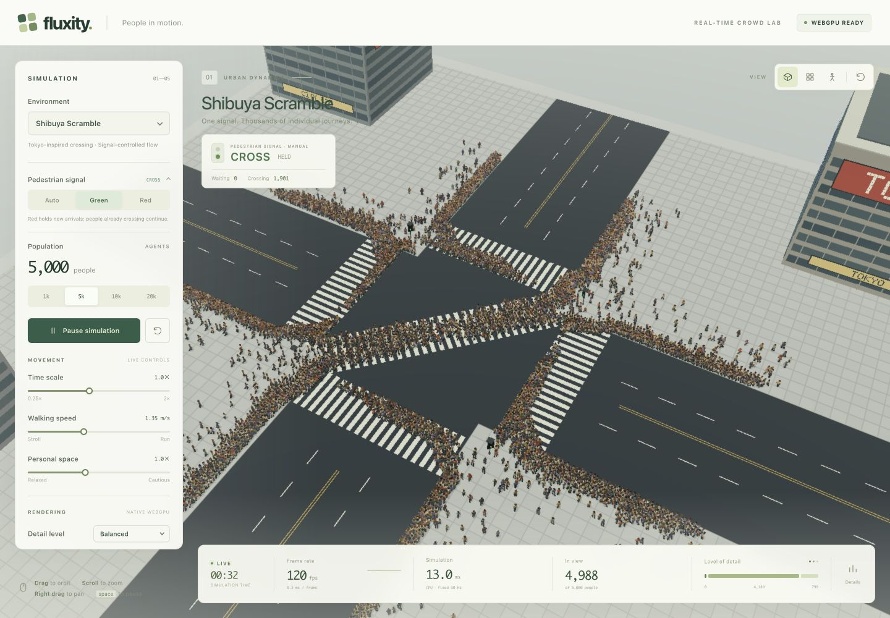

# Fluxity — People in motion

ネイティブ **WebGPU / WGSL** と TypeScript で作った、リアルタイム3D群集シミュレーション。ゲームエンジン、3Dエンジン、WebGL、リモートの人物アセットは使用しません。



## 起動

Node.js **22.12以上**（または新しいLTS）を使用してください。

```sh
npm install
npm run dev
```

表示された `http://127.0.0.1:5173` を開きます。初期状態は **Shibuya Scramble / 5,000人 / seed 42 / 自動信号** です。

```sh
npm run typecheck  # strict TypeScript
npm test           # 数値・経路・メモリ境界のテスト
npm run build      # 型チェック + dist/ への本番ビルド
npm run preview    # ビルド結果をローカルで確認
npm run benchmark  # Node上のCPUシミュレーション性能測定
```

推奨環境は、ハードウェアアクセラレーションが有効なWindows/macOSの最新ChromeまたはEdgeです。WebGPUを実装した他のブラウザでも利用できます。`localhost` / `127.0.0.1` またはHTTPSのsecure contextが必要です。GPU・ドライバ・ブラウザのポリシーによって利用できない場合は、画面に原因と推奨環境を表示します。WebGLへの代替実装はありません。

## GitHub Pagesへの公開

このアプリは静的ファイルだけで動作し、バックエンドは不要です。`shuichi/fluxity` の標準の公開先は **https://shuichi.github.io/fluxity/** です。

1. リポジトリの [Settings → Pages](https://github.com/shuichi/fluxity/settings/pages) を開き、**Build and deployment → Source** を **GitHub Actions** にします。
2. [公開用ワークフロー](.github/workflows/deploy-pages.yml) を含む変更を `main` にコミット・pushします。

   ```sh
   git add .github/workflows/deploy-pages.yml README.md
   git commit -m "Add GitHub Pages deployment"
   git push origin main
   ```

3. [Actions](https://github.com/shuichi/fluxity/actions) の **Deploy to GitHub Pages** が成功したら、公開URLを開きます。ワークフローを先にpushした場合は、Pages設定後に **Run workflow** から `main` を選んで実行できます。

以後は `main` へのpushで自動更新します。Node.js 24で `npm ci` → `npm test` → `npm run build` を実行し、成功したときだけ `dist/` を公開します。`dist/` のコミットや、個人アクセストークン・追加Secretsの登録は不要です。

Viteの `base: './'` により、JavaScript・CSS・favicon・Workerを `/fluxity/` 配下から読み込めます。WebGPUにはHTTPSと対応ブラウザ・GPUが必要です。公開URLは `https://` で開いてください。SharedArrayBufferを使わないため、追加のCOOP / COEPヘッダー設定は不要です。

公開処理が失敗した場合はActionsの失敗したステップを確認してください。`Configure Pages` で失敗する場合はSourceが **GitHub Actions** になっているか、`Deploy to GitHub Pages` で権限エラーになる場合は `github-pages` 環境の保護ルールで `main` が許可されているかを確認します。

参考：[GitHub公式のカスタムワークフロー手順](https://docs.github.com/en/pages/getting-started-with-github-pages/using-custom-workflows-with-github-pages)、[Viteの相対base設定](https://vite.dev/guide/build#relative-base)。

## 操作

- 左ドラッグ：カメラ回転。右ドラッグ：平行移動。ホイール：ズーム。
- カメラツールバー：Perspective / Overview / Street、視点リセット。`R`でもリセット。
- Pause / Resume、または `Space`：一時停止・再開。
- Reset：同じ設定・同じシードで再初期化。
- Population：1,000 / 5,000 / 10,000 / 20,000人。
- シナリオ：Shibuya Scramble、City Plaza、Bidirectional Corridor、Bottleneck、Crossing Flow。
- ShibuyaのPedestrian signal：**Auto / Green / Red**。青では横断を開始し、赤では新しい横断者が歩道で待機します。すでに横断している人は赤になっても渡り切ります。信号の変更で群集はリセットされません。
- 信号表示：現在の状態、次の自動切り替えまでのシミュレーション秒数、待機人数、横断人数。シミュレーション停止中でも手動で信号を変更できます。
- 自動信号は赤12秒・青35秒のデモ周期です。Autoへ戻すと現在のシミュレーション時刻の周期へ復帰します。
- Simulation speed、Walking speed、Avoidance：実行中に調整可能。
- Seed：再現可能な初期配置・外観・目的地選択。
- Quality：解像度とLODのプリセット。Debug：描画診断。
- 詳細統計：可視人数、LODごとの人数、Draw Call、三角形数、CPU描画準備時間、描画解像度。
- Benchmark：4つの人数を順に**2秒ウォームアップ＋4秒計測**。FPS、Frame time、Simulation step、Draw Callを比較し、終了後は元の人数と再生状態に戻ります。計測中は同じカメラ・シナリオ・品質で比較してください。タブを非表示にすると計測を中止します。

ブラウザが非表示の間はWorkerも停止します。復帰時に経過時間分の計算を積み上げません。

## 実装

- **Simulation**：DOM/WebGPUから独立したCPUのSoA状態。固定30 Hz、読み取り状態と次状態を分離。シード付き乱数。
- **Navigation**：障害物を含む歩行可能グリッドと目的地共有Flow Field。
- **Scramble crossing**：車道・歩道・斜めを含む横断歩道と商業ビルからなる、渋谷に着想を得たステージ。描画と経路探索で横断歩道の配置データを共有します。信号はWorkerのシミュレーション時計で制御します。
- **Avoidance**：Uniform Gridによる近傍探索、目的地誘導、予測回避、速度調整、加速度・旋回速度制限、壁の押し戻し。
- **Worker**：上限付きの固定ステップ更新。Transferable ArrayBufferのプールを使用し、世代番号でリセット前の結果を除外。SharedArrayBuffer / COOP / COEPは不要。
- **Rendering**：WebGPUを直接使用。前後2スナップショットの位置・向き・歩行位相を補間し、requestAnimationFrameで表示。
- **People**：共有プロシージャルメッシュ。頭・髪・胴・腕・脚・靴を生成。体格・肌・服を個体ごとに変化。WGSLの頂点シェーダでIdle / Walk / Runの関節運動を計算。
- **Batching**：画面投影サイズによる3段階LOD、ヒステリシス、Frustum Culling、LODごとのInstance Compaction。人数に比例するDraw Callは発行しません。
- **Environment**：舗装、建物、シナリオ障害物、植栽、Directional / Ambient Lighting、距離フォグ、Instanced Quadの接地影。
- **UI**：HTML/CSS/TypeScriptのみ。実測の統計と非対応時のエラー表示。

詳細は [docs/architecture.md](docs/architecture.md) を参照してください。群集の経路探索・局所回避・信号制御の数式と原典は [アルゴリズム解説](docs/algorithms.html) にまとめています。このHTMLは本番ビルドにも含まれ、GitHub Pagesでは `/fluxity/docs/algorithms.html` で公開できます。

## 計測と性能

目標は1920×1080で60 FPS、CPUシミュレーション30 Hzです。達成を保証するものではありません。実際のFPSは端末、GPU、ブラウザ、ウィンドウサイズ、カメラ、密集度で変わります。

画面の **Frame time** はrequestAnimationFrameの間隔、**CPU render** はカリング・データ転送・コマンドエンコードを含むCPU経過時間、**Simulation step** はWorkerの固定ステップ計算時間です。GPU完了時間とは異なります。GPU timestamp計測は未実装であり、GPU時間を推定表示しません。`timestamp-query` / `indirect-first-instance` 等のオプション機能を要求しません。

`npm run benchmark` はCPUのみの再現可能な測定です。ブラウザ内のBenchmarkは、その時点の描画を含む計測です。高密度のBottleneckでは局所回避の負荷が大きくなるため、広場と分けて比較してください。

2026-11-17の実機検証では、1920×1080 / Balanced / 広場で1,000〜20,000人を約120 FPSで描画し、20,000人のCPU計算は平均27.13 ms/stepでした（各条件4秒の短時間計測）。渋谷ステージは経路制約と密集度が異なるため、この広場の数値は流用できません。混雑が進むと5,000人でもCPU計算が30 Hzの時間枠を超える場合があり、20,000人ではさらに負荷が増えます。比較時には信号をGreenまたはRedに固定してください。

信号機能の追加後、**50件の自動テスト・型チェック・本番ビルド**に成功しています。条件・人数別の数値・スクリーンショット・未検証範囲は [検証記録](docs/validation.md) に記載しています。

## 制約・拡張

- 軽量なSteeringモデルです。厳密なORCAや研究用途の歩行者モデル、物理的に完全な非貫通・群集圧力の保証はありません。過密状態では滞留や重なりが起こり得ます。
- 渋谷ステージはスタイライズした模擬空間です。実際の道路寸法・建物・信号周期の精密な再現ではなく、車両シミュレーションも含みません。赤信号では横断開始を抑止し、横断中の歩行者が車道上で一斉停止しないようにしています。過密時には出口の歩道に滞留が生じ、全員が一定時間内に渡り終える保証はありません。
- Flow Fieldは静的シナリオ用です。動的障害物、NavMesh、個別のA*、マルチフロアは未実装です。
- glTF / スキニング / Animation Texture、GPU Computeによるカリング・シミュレーション、Indirect Draw、正確なGPU timestamp計測は将来の拡張です。
- GPUバッファは最大20,000人向けに確保します。20,000人超への拡張では上限、シミュレーション密度、転送量、カリングを再評価してください。
- WebGPUのDevice loss・初期化失敗・WGSLコンパイル・Validation errorを診断します。Device loss後の自動復旧はせず、再読み込みを案内します。
- 描画とSimulationの境界は数値配列とメッセージのみです。SimulationをRust/WASMへ置き換え、同じSnapshot契約を維持できます。

実行時に外部CDN・フォント・画像・モデルのダウンロードは発生しません。

## 仕様参照

- [WebGPU specification](https://www.w3.org/TR/webgpu/)
- [WGSL specification](https://gpuweb.github.io/gpuweb/wgsl/)
- [Shibuya Crossing — Japan National Tourism Organization](https://www.japan.travel/en/spot/2177/)（ステージの着想）

## License

[GNU General Public License v3.0](LICENSE)
