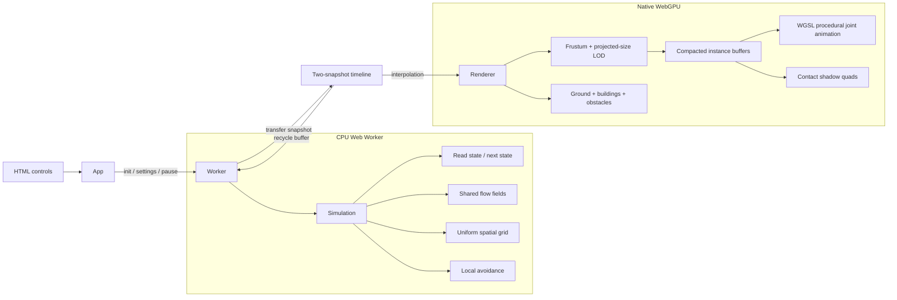

# Architecture

## Source boundaries

| Path | Responsibility |
| --- | --- |
| `src/types.ts` | Data-only protocol and binary snapshot contract |
| `src/app/App.ts` | Lifecycle, worker orchestration, render loop, visibility, benchmark |
| `src/app/SnapshotTimeline.ts` | Exactly two retained snapshots and recycling ownership |
| `src/app/Controls.ts`, `StatsPanel.ts` | Accessible DOM controls and measured telemetry |
| `src/simulation/` | Deterministic numeric core, spatial grid, steering, navigation, worker |
| `src/scenarios/` | Declarative scene bounds, obstacles, spawns and destinations |
| `src/simulation/TrafficSignal.ts` | Interlocked pedestrian, east–west and north–south signals, including manual requests |
| `src/simulation/VehicleTraffic.ts` | Through-lane car following, stopping distances and pedestrian clearance |
| `src/simulation/VehiclePath.ts` | Distance and heading along each curved vehicle route |
| `src/renderer/RoadMarkings.ts` | Split mapped asphalt faces along lane paint, stop bars and pavement boundaries |
| `src/simulation/ScrambleGeometry.ts` | Shared sidewalk/zebra surface, curb limits and tangential boundary sliding |
| `src/simulation/UrbanGeometry.ts` | Indexed polygon boundaries, holes, swept movement and curb-normal braking |
| `src/renderer/ScrambleEnvironment.ts` | Pedestrian and vehicle signal fixtures, stop lines and synthetic crossing scenery |
| `src/renderer/UrbanMesh.ts` | Version-checked binary loading, CPU cache and mesh merging |
| `scripts/import-plateau.py` | Pinned CityGML extraction, projection, triangulation and geometry validation |
| `data/shibuya/layout.json` | Calibrated crosswalks, plaza corrections, signals, spawn zones and destinations |
| `src/renderer/` | WebGPU resource ownership, camera, mesh generation, LOD and culling |
| `src/shaders/` | WGSL environment, human and contact-shadow rendering |
| `src/tests/` | Determinism, numerical constraints, navigation and buffer contracts |
| `scripts/benchmark.ts` | Repeatable CPU-only workload comparison |

## Time and ownership

Simulation advances by exactly `1/30` seconds. Simulation speed changes how quickly fixed ticks are scheduled, not the integrator step size. Catch-up is bounded, so sustained overload slows simulated wall-clock progress rather than causing an unbounded task queue. A paused or hidden document does not accumulate missed work.

The worker owns the mutable SoA state. The main thread never accesses it. Snapshots are tightly packed Float32 arrays; transfer relinquishes the sending side's ArrayBuffer ownership. The main thread retains previous/current states and returns the older buffer when a new state arrives. Reset increments a generation counter, so results from a prior population or scenario cannot be interpreted with the new layout.

Rendering interpolates between received positions using a common timestamp. Heading follows the shortest angular path. In vehicle scenes the renderer uses both streams' current positions directly if a step was missed, a signal indication changed, or a pedestrian or vehicle slot changed lives. This keeps the displayed trajectories within the intervals checked by the simulation.

## Shibuya intersection signals

Shibuya is the default scene, with 1,000 people. `Scenario.urbanMap` contains unioned sidewalk and walkable polygons with holes; buildings and traffic islands are excluded. `Scenario.scramble` contains five crosswalk segments and explicit signal directions. The importer builds both painted crossings and the navigable union from the same calibrated layout. Navigation uses a 0.75m grid within the 250m simulation bounds; the background covers 500m. The legacy synthetic crossing remains a regression fixture and uses `roadHalfWidth`.

The controller has three independently reported signals. Its automatic sequence follows the 140-second cycle observed at Shibuya Station at about 18:00 on 25 August 2020. Each row shows the time until the next service can start in an empty intersection. All pedestrian and vehicle heads show red during clearance. [Field observation](https://www.shingou-saikuru.com/2019/01/shibuya-sta.html) · [Shibuya signal-control study](https://www.jstage.jst.go.jp/article/pjsai/JSAI2022/0/JSAI2022_3N3GS1003/_pdf/-char/ja)

| Service | Green | Warning | Minimum all-red |
| --- | --- | --- | --- |
| All five pedestrian crossings | 37 s | 10 s flashing green | 4 s |
| East–west vehicles | 44 s | 3 s amber | 3 s |
| North–south vehicles | 33 s | 3 s amber | 3 s |

The controller extends all-red until the last pedestrian has cleared the road and the rear of the last car has passed the far crossing. Each new service gets its full green interval. Manual controls request the next service or an all-red hold. Changing the request during a warning or clearance preserves those intervals. Simulation time governs timing and flashing, including pause and playback speed.

The four through routes follow the bends of their respective carriageways and pass on either side of the station-side island. Arc length along each route determines speed, headway and distance to the stop line. Vehicle headings blend across adjacent segments. The pedestrian clearance check includes the rotating corners of the vehicle at each bend. Each driver has a seeded cruising speed of 20–30 km/h and adjusts speed for the vehicle ahead. At the start of amber, distance to the stop line and safe stopping distance determine which cars can stop and which need to pass. Red bars crossing the stop line. Each tick checks proposed pedestrian movement against current car bodies, then limits car travel using accepted pedestrian sweeps. New cars and replacement pedestrians also check their starting locations. [Japan’s Road Traffic Act Enforcement Order, Articles 2–3](https://laws.e-gov.go.jp/law/335CO0000000270)

`CrosswalkFlow` follows the destination field to identify the next marked crossing. Across its width it samples parallel paths that connect the two sidewalks and leave enough room for a walker. An approaching pedestrian chooses a lateral position and keeps it through the crossing. Where two markings meet, the part of the approach before the chosen marking must stay on the sidewalk. A pedestrian already on another marking waits to pick the next crossing track. One-way flows can use the whole available width. When streams meet, each increasingly favors its right-hand side according to the number of walkers approaching from the opposite direction. Local avoidance can move a walker up to 0.8 m past the edge of the marked crossing. Clearing the crossing takes priority once flashing green begins.

Flashing green and red close the crossing to new pedestrians. Each person already on the road chooses the nearest reachable sidewalk, which can mean completing the crossing or turning back. The clearance pace increases a walker's preferred speed by up to 25%, with the increase capped at 2.8 m/s. A zero walking speed keeps the person in place and holds traffic. The pedestrian keeps their trip destination and commits to clearing the road even if green resumes. If progress stalls at a crowded curb, the walker compares the crowd along visible approaches to other landing points on the same sidewalk, within 12 m of the current landing. Nearby pedestrians waiting to cross can step back to make up to 2.1 m of space at the curb. A bend in the crossing can require an intermediate waypoint on the navigation grid. People in the way step back or sideways on the sidewalk. If the first row cannot make space, walkers farther back also yield. The signal counts crossers until their whole body clears the curb.

The worker sends the confirmed `SignalState` (requested mode, three actual indications, remaining time, waiting and crossing counts) as snapshot metadata. Settings can publish a same-step snapshot while paused; exhausted pools mark a pending update and publish when a recycled buffer arrives. The UI and GPU signal lamps use this confirmed state. Lamps are vertex material IDs driven by the existing scene uniform, with no additional draw call or per-change geometry creation.

## Storefront entrances

Shibuya uses the same ground-floor facade positions and widths for its 50 rendered storefronts and their walking lanes. At wide openings people entering a building approach the outer lanes, and those emerging use the middle lanes. Pedestrians rejoin ordinary steering once their body has cleared the facade and the public sidewalk is reachable. The choice of a new pedestrian’s exit also takes account of slow-moving people directly outside the opening. A walker blocked while joining a lane on the sidewalk can release their place and approach again. Replacements still enter the scene only after another pedestrian has walked through a different portal.

An empty storefront leaves the sidewalk route open. When a visible pedestrian is moving through the opening, another walker whose path intersects theirs can step aside. A pedestrian committed to a doorway keeps shoulder clearance during the merge. Between ordinary sidewalk walkers the collision check uses the physical body radii. Passage queues track the leader's trip generation so a new person reusing a slot cannot block the previous queue.

On an urban sidewalk, each walker checks for a slower or opposing pedestrian ahead every half second. They compare the straight route with short paths up to 3.5 m to either side of its bearing. Each candidate must fit on the sidewalk at the walker's body width. The walker follows a clear path for a few steps and then reassesses. Signal and doorway movements take precedence.

The default Shibuya scene has ten street gateways along the two sidewalks of five outward streets. Each trip draws a purpose from the person ID, trip generation and scenario seed. The scenario assumes 50% through traffic, 25% shopping and 25% departures from a shop to a street. Feasible street-to-street trips connect different directions. The north-only control substitutes an interior origin for a through trip. A replacement prefers an available origin matching its purpose; if none is available it may emerge elsewhere. The four layout variants share the same initial placement constraints.

When enabled, Shibuya creates a `PortalDeadlockRecovery` controller for each destination in the map’s portal list. Each independently reviews nearby walkers bound for that destination once per simulation second. It observes the 12 m around a storefront’s facade or a street exit’s public-side mouth. It tracks progress toward accessible lanes and counts completed trips through the portal. It intervenes when several walkers stop gaining ground and admissions stop, or when a group near the front is persistently left behind while others pass.

At a storefront the controller admits a limited number of shoppers to each lane. They may approach either admission bank. At a street exit each walker keeps the lane assigned to their trip. During a blockage, the controller holds back walkers at least 5 m from their lane mouth if they were outside the initially stalled group. People at the front and those already blocked can close gaps under ordinary steering, subject to the passage’s existing lane reservations and headway.

The controller uses the mapped emergence lanes to leave room for people coming the other way. It can ask a walker blocking the approach to step aside on the sidewalk. Crossing clearance, speed limits and the existing movement constraints still apply. The controller releases its orders when the original blockage clears or no one completes the passage for 20 seconds. Other destinations can continue their own interventions.

## Snapshot ABI

Each pedestrian slot occupies **16 Float32 values / 64 bytes**.

| Float offset | Value |
| --- | --- |
| 0, 1 | Ground-plane position x, z |
| 2 | Heading in radians; 0 faces +z |
| 3 | Actual movement speed, metres/second |
| 4 | Continuous animation phase |
| 5 | Appearance ID |
| 6 | Body scale |
| 7 | Animation clip ID |
| 8, 9, 10 | Clothing tint RGB |
| 11 | Life generation, incremented when a slot is reused for a new trip |
| 12 | Visibility through the entrance or exit passage (0–1) |
| 13 | Head yaw relative to the torso, in radians. The first-person view follows the same interpolated angle. |
| 14 | Signed shoulder reaction to contact (−1 to 1). Positive values lean to the pedestrian's right. |
| 15 | Selfie pose (0–1), interpolated with the hand and handset. |

The same buffer carries `vehicleCapacity` vehicle slots after the `count` pedestrian slots. Each occupies **5 Float32 values / 20 bytes** and stores x, z, heading, life and speed in m/s, in that order. A zero life marks an empty slot. An active slot receives a new life when it is reused. Scenarios without traffic have zero vehicle slots.

This is a CPU transfer format. The renderer repacks visible instances into its WGSL-aligned storage layout. GPU structures use 16-byte lanes; the corresponding TypeScript stride and WGSL members are defined together in the renderer. No per-agent GPU resources or draw calls are created.

## Attention and encounters

`PedestrianAttention` seeds each life's gaze and familiarity independently of trip generation. A curb wait schedules its next glance in simulation seconds. The pedestrian can look toward a crossing, its signal or a passing walker. A staggered route check permits a brief slowdown when two walkable directions around an obstruction have comparable remaining cost to the same destination. The head can turn while the body stands still.

`Steering` scores continuing, passing on either side and yielding using nearby walkers' projected closest approaches. It tests the preferred maneuver against the walkable surface and carries the choice across ticks. A mild contact with sufficient measured closing speed produces a brief torso roll. The response rearms after leaving the contact cluster. Doorway movement, signal restrictions and final geometry constraints retain priority. A replacement pedestrian starts with fresh attention and encounter state.

The Shibuya presets cast runners, photographers and companions from existing trips with a separate seeded random stream. Both walking models use the same initial cast. The enhanced model guides companions toward a comfortable side-by-side spacing on compatible crossing tracks. It uses finite-horizon velocity obstacles and ORCA half-planes during free movement on an active green crossing approach or track. The solver selects the next velocity within the speed and acceleration discs, with bounded relaxation when the constraints conflict. A photographer committed to stopping leaves the avoidance correction to the passer. Density-guided entry is enabled by default in Enhanced. It samples local density and opposing flow to select a crossing track, and can be turned off in the controls. See the [algorithm notes](algorithms.html) and [1,000-person comparison](results/shibuya-crossing-behavior.md).

## Extension points

- Replace `Simulation` behind the worker protocol with Rust/WASM without changing the UI or renderer.
- Replace flow fields with a navigation provider using NavMesh or hierarchical planning.
- Replace procedural joints with baked animation textures or storage-buffer palettes. Keep per-instance speed, appearance, phase, and clip IDs.
- Move frustum/LOD selection and instance compaction to a compute pipeline. Retain the CPU path for devices without the required features or limits.
- Add optional GPU timestamp queries only after checking adapter features and explicitly requesting them. Keep CPU and GPU time labels separate.

## Rendering resource lifetime

Meshes, instance capacity, uniforms, bind groups and pipelines are long-lived. Scenario changes rebuild static environment geometry. For Shibuya, asynchronous loading validates byte lengths, SHA-256, vertex normals, index bounds, UVs and atlas pages before GPU upload. Worker initialization waits for the matching scenery; generation tokens reject stale scenery loads as well as old worker snapshots. Successful geometry and compressed image Blobs are cached. The renderer decodes fresh ImageBitmaps on each scene entry and closes every bitmap after upload, failure or cancellation; GPU buffers and textures remain renderer-owned. Atlas allocation including mipmaps is capped at 128MiB, and the current five pages use about 106.7MiB. Photo/Solid switches a uniform; the loaded textures remain resident. Canvas size or quality changes resize the depth target; the maximum texture dimension and device pixel ratio cap bound allocation. Destruction releases owned buffers/textures/device resources and event listeners. Initialization checks WebGPU availability, adapter/device failures, feature/limit compatibility, shader compilation, and validation errors.

## Verification

`npm test`, `npm run typecheck`, and `npm run build` are the automated gates. `npm run benchmark` measures the CPU core. Browser validation must additionally check actual WGSL compilation, visible human geometry, motion, pause/resume, scenario changes, 20,000-agent operation, camera controls, and resizing. A successful build alone does not establish GPU correctness.

## PLATEAU data boundary

The conversion pipeline reads four pinned CityGML meshes. JGD2011 latitude/longitude is projected to plane rectangular zone IX and centered at 35.6595N, 139.7005E; the app uses x east, y up, z south. Each building is grounded using its lowest source geometry height, preserving its relative roof/wall shape. The data is an explicitly flattened ground study without multilevel navigation. Building photographs come from the same CityGML Appearance references; source ring IDs bind each photograph's UV coordinates to the geometry.

The renderer receives 40-byte geometry vertices and uint32 indices, plus a separate 12-byte-per-vertex appearance stream (UV and atlas page). Photo images are packed offline into equally sized atlases and uploaded as a mipmapped texture array. A page of -1 preserves solid materials for ground, signals and faces without photos. The Photo/Solid control changes rendering without resetting the simulation. The Worker imports the smaller polygon map, never the building rendering buffers or photographs. Buildings and map surfaces are triangulated offline with concave rings and holes; ground, road, sidewalks and zebra markings tile the plane without coplanar overlap. Provenance, source hashes, selected building IDs/LOD, manual corrections and limitations are recorded in `public/data/shibuya/manifest.json`. Reproduction steps are in [plateau-data.md](plateau-data.md).

PolygonRegion packs boundary segment IDs into contiguous lists for 1 m horizontal rows and 4 m square cells. The cell index covers each region's bounding rectangle. Cells without boundary segments store their inside/outside result, and a pedestrian whose body extends into a neighboring cell still checks the nearby edges for clearance. Swept segment checks and tangential sliding use the same clearance as classification. Before storing positions, UrbanGeometry validates Float32 rounding and, only when needed, reserves 0.1mm inward without increasing the requested travel distance. This keeps curb-side waiters from becoming crossers due to rounding. Flow fields retain only the connected component shared by all destinations; spawn cells come from valid sidewalk cells in that component. Shibuya chooses each trip’s purpose and destination at departure.
