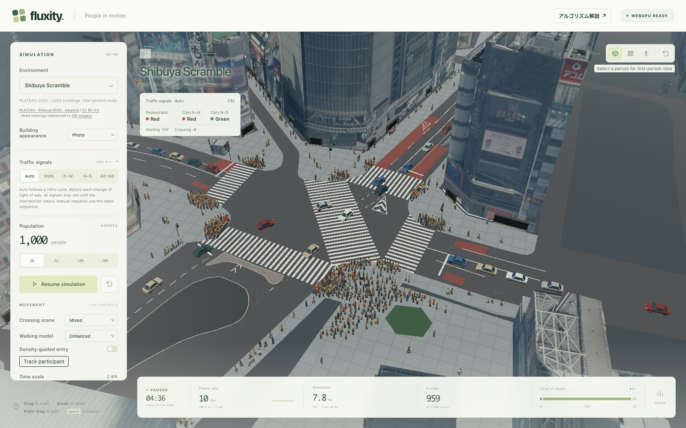

# ハチ公口の細歩道と駅広場の人流

修正前、横断端と駅広場を地上で接続した場合、その地図に広さ・混雑を使う経路選択と信号待ちを加えた場合を比較した。シード42・137の各条件で同じ1,000人から始め、6分間に歩行者青を3回観測した。これはシミュレーション内の比較で、実地の人流との照合は行っていない。



画像は更新した地図からの通常起動で、4分36秒の全体の信号待ちは537人、横断中0人。歩行者と東西車両は赤、南北車両は青だった。以下の表は旧地図から同一の初期配置・旅程を与えた比較で、同じ時刻でも人数と信号の段階が変わる。

## 画像と同じ4分36秒で人がいた場所

| シード | 条件 | 細歩道 | 駅広場 | 接続補正部 | 広場のうち奥 | 全体の信号待ち |
| ---: | --- | ---: | ---: | ---: | ---: | ---: |
| 42 | 修正前 | 381 | 65 | 0 | 3 | 466 |
| 42 | 地図のみ | 303 | 14 | 53 | 4 | 465 |
| 42 | 地図＋経路・待機 | 178 | 159 | 27 | 33 | 561 |
| 137 | 修正前 | 355 | 89 | 0 | 8 | 459 |
| 137 | 地図のみ | 285 | 34 | 63 | 7 | 425 |
| 137 | 地図＋経路・待機 | 176 | 159 | 33 | 34 | 513 |

「奥」は駅広場の内数。地図のみの条件では、追加した約31 m²の接続部に53人・63人が集まった。経路・待機を加えると、同時刻の広場奥はシード42で3人から33人、137で8人から34人に増えた。

## 横断後に駅広場へ抜けた人と、接触・混雑

| シード | 条件 | 駅側着地のうち広場奥に到達 | 赤時の細歩道人数 P95 | 赤時に最も混んだ3 m四方 P95 | 全横断完了 | 目的地に到着 | 接触反応 | 更新 P95 (ms) |
| ---: | --- | ---: | ---: | ---: | ---: | ---: | ---: | ---: |
| 42 | 修正前 | 22/672 (3.3%) | 390 | 49 | 1755 | 910 | 3480 | 13.09 |
| 42 | 地図のみ | 39/823 (4.7%) | 310 | 37 | 2172 | 1043 | 5494 | 12.48 |
| 42 | 地図＋経路・待機 | 111/829 (13.4%) | 184 | 32 | 2133 | 1028 | 3603 | 10.40 |
| 137 | 修正前 | 30/677 (4.4%) | 371 | 47 | 1784 | 917 | 3602 | 13.10 |
| 137 | 地図のみ | 30/713 (4.2%) | 300 | 44 | 1950 | 997 | 5957 | 13.05 |
| 137 | 地図＋経路・待機 | 96/726 (13.2%) | 183 | 34 | 1977 | 995 | 3765 | 10.45 |

全6条件で赤または青点滅中の新規進入は0件。地図と経路・待機を適用すると、修正前より両シードで駅広場奥へ進んだ割合が上がり、駅側の局所的な混雑が下がった。接触反応は修正前からシード42で3.5%、137で4.5%増えた。地図だけを補正した条件に比べると両シードで減った。

## 赤の間に駅側へ来た人の待ち時間

| シード | 条件 | 対岸完了 | 待ち中央値 (秒) | 待ち P95 (秒) | 終了時未進入 | 終了時横断中 | 駅側へ戻った進入回数 | うち駅側歩道から2 m以上離れた回数 |
| ---: | --- | ---: | ---: | ---: | ---: | ---: | ---: | ---: |
| 42 | 修正前 | 406 | 120.47 | 276.13 | 96 | 190 | 109 | 57 |
| 42 | 地図のみ | 614 | 112.30 | 169.60 | 233 | 24 | 76 | 41 |
| 42 | 地図＋経路・待機 | 613 | 112.70 | 131.20 | 264 | 24 | 112 | 94 |
| 137 | 修正前 | 471 | 118.93 | 277.53 | 57 | 182 | 75 | 35 |
| 137 | 地図のみ | 526 | 117.40 | 134.40 | 36 | 138 | 64 | 43 |
| 137 | 地図＋経路・待機 | 555 | 119.60 | 135.43 | 21 | 137 | 52 | 32 |

横断歩道の幅に沿って求めた最寄りの縁石から14 m以内に待機位置を置いた。横断端から21 mまで使った試行と比べ、2 m以上車道へ出て戻った回数はシード42で200→94件、137で157→32件。修正前との比較では42で37件増え、137で3件減った。待ち時間の95%点は21 mまで使った試行の268.83秒・272.30秒から131.20秒・135.43秒になった。待ち時間の集計対象は対岸に到着した人。表の終了時未進入・横断中は時刻打ち切りで待ち時間の分位に含めていない。観測中に横断を終える前に目的地で次の人物に入れ替わった対象者は全条件で0人だった。

## 計測方法

各条件は1,000人、Mixed / Enhanced、歩行速度1.35 m/s、回避強度1、自動信号、30 Hzで6分間とした。横断歩道入口の既存オプション「Density-guided entry」はオフ。開始時の位置・速度・向き・歩行位相・体格・外観・希望速度・目的地・入口レーン・同行者・行動役をシードごとに照合した。修正前は作業中の変更を含むソースを着手時に保存して実行した。比較用ランナーは旧地図で初期化してから各条件の地図で歩き始める。通常起動で新地図の歩行可能域から改めて初期位置を抽選すると、シード42では208人の初期x座標が変わる。

- **細歩道と広場**は、修正前の駅側歩道ポリゴン内で身体半径0.34 mを確保した0.125 m格子のうち、地図座標 (5, 40) と (20, 40) から各々到達できる領域。中心点に使える面積はそれぞれ約252 m²、1,093 m²。縁にいる人は元の歩道面内で最寄りの有効セルに対応づけた。新たに接続した部分の人数は別欄に載せた。店舗などの通路内を除き、待機者・移動中の人を含める。
- **広場奥**は、元の駅広場補正ポリゴンの境界から3 m以上内側で、駅側の三つの横断端すべてから8 mを超えた歩道。「着地後に広場奥へ」は、別の歩道から駅側に渡り切ったのち、同じ旅程のままこの面まで来た件数を一着地につき1回数えた。
- **赤時の集中**は歩行者赤信号の間、毎秒観測。各秒に駅側の全域を固定3 m四方に区切り、最も人数の多いセルを記録した。その時系列の95パーセンタイルを示した。細歩道の95%点は各秒の細歩道の全人数から算出した。
- **駅側の待ち時間**は、駅側歩道の地図座標 x = 0〜52 m・z = 12〜49 mで、別の歩道に目的地のある歩行者を赤の間に初めて捉えた時刻から、駅側歩道を離れ横断歩道へ進入するまで。赤の観測は毎秒、進入は毎ステップ。歩行者が同じ旅程で対岸へ着いたものを中央値と95%点に含めた。接近・広場への移動もこの区間に入る。終了時にまだ進入していない人、進入済みで対岸未着の人、同じ歩道への引き返しを別掲した。同じ歩道に戻ったときは最初の赤到着時刻を保持し、次に対岸まで渡り切れた回の進入を終点とする。引き返しのうち、身体中心が出発歩道の外側へ2 m以上離れたものを区別した。
- **接触反応**は、身体半径の和まで接近し、接近速度が0.22 m/sを超えたときに上体を引く反応を人物単位で数える。同じ密集の中で触れ続けている間は再加算を抑える。**CPU**はNode.js v26.13.1 / macOS arm64で、10,800回のシミュレーション更新だけを計時した95%点。計測プロセスを並行実行しており、負荷によって値は変動する。

別途、補正後の地図で全赤固定・シード42とし、経路選択と広場待機を無効・有効の順に単独実行した。最初の60ステップを除いた240ステップのCPU更新時間の95%点は、1,000人で10.86→10.66 ms、5,000人で58.91→59.75 msだった。この環境の5,000人では、両条件で30 Hzの予算33.33 msを超えた。

## 再現手順

旧地図ファイルのSHA-256は `9be7561e157ef236764a2fb8cdad0dba1bf9b1a19220d520dfce8ae5e20cc7ae`。下のコミットから取り出したファイルが計測前に保存した地図とバイト単位で一致することを照合した。

```sh
git show 13e467bbc1ea3249957c413a47925978cb6e2c81:src/scenarios/data/shibuya-map.json > /tmp/fluxity-original-shibuya-map.json
shasum -a 256 /tmp/fluxity-original-shibuya-map.json
for seed in 42 137; do
  for variant in original geometry combined; do
    node --import tsx scripts/compare-shibuya-forecourt.ts --seed="$seed" --variant="$variant" --seconds=360 --reference-map=/tmp/fluxity-original-shibuya-map.json
  done
done
```

開始時のSHA-256はシード42で `584150239c2572a4a90343bc065bcc2633bbb088bfe461d6bda4533c236268f6`、137で `8be48fa2b71823d82d1829f9f6da46b7d737c204bca72987b989bd3485d452b1`。
