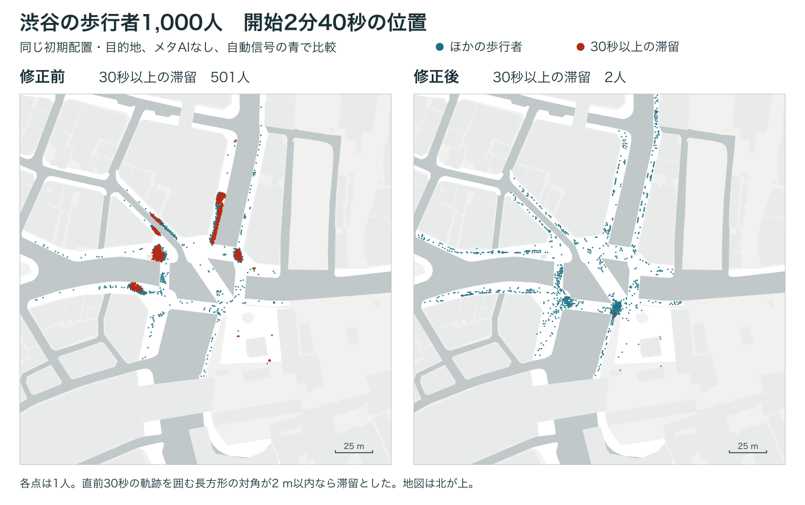

# 渋谷の全域で測った歩行者の滞留

画面と同じ渋谷の標準シナリオで、50店舗と全方向の街路端10か所を開き、1,000人を18分29秒間追跡した。シード42、自動信号、歩行速度設定1.35 m/s、パーソナルスペース1.0倍、時刻倍率2.0倍、メタAI無効。毎秒30ステップを計算し、1秒ごとに同一人物の位置を記録した。開始時の全員の位置、属性、目的地、速度、向きのハッシュは両条件で一致した。各セルは「修正前 → 修正後」の人数を表す。

2分40秒時点で、直前30秒間の移動が2 m以内に収まった人数は501人から2人へ減った。18分29秒間に5分以上留まった人数は673人から0人になり、修正後は全60地点それぞれで16人以上が入店・退出した。

## 画面と同じ時刻・長時間での変化

各歩行者について直前30秒、60秒、300秒の全観測位置を囲む地図軸に平行な長方形を求め、その対角線が2 m以内に収まるとき、その間の滞留として数えた。渋谷マップのすべての場所と移動段階、出発地点も対象に含む。到着して次の人に入れ替わるたびに観測をリセットする。半径5 m最多は、歩行者を1人ずつ中心にした円のうち、最も多くの人を含む円の人数。入店・退出は開始から各時刻までの累計。

| 時刻 | 30秒滞留 | 60秒滞留 | 300秒滞留 | 半径5 m最多 | 半径5 m内の30秒滞留者最多 | 入店 | 街路退出 |
| --- | ---: | ---: | ---: | ---: | ---: | ---: | ---: |
| 2分40秒 | 501 → 2 | 376 → 0 | — | 144 → 117 | 113 → 2 | 95 → 236 | 171 → 452 |
| 7分40秒 | 652 → 1 | 567 → 0 | 264 → 0 | 179 → 88 | 144 → 1 | 212 → 665 | 475 → 1,902 |
| 18分29秒 | 746 → 1 | 704 → 0 | 620 → 0 | 189 → 118 | 144 → 1 | 273 → 1,649 | 657 → 4,800 |

2分40秒ちょうどの信号は青で残り28秒。この時刻では5分間の観測はまだ成立しない。7分40秒から18分29秒までの10分49秒間に追加で入店・退出した人数は 243 → 3,882 人だった。

## 画像の時刻に人が集まっていた場所



修正前の2分40秒で30秒滞留者が最も多かった3地点を選び、同じ中心・同じ半径5 mで比較した。地点名は各円の中心に最も近い店舗入口に合わせた。

| 場所 | 中心座標 (x, z) m | 円内の全人数 | うち30秒滞留 |
| --- | ---: | ---: | ---: |
| 店舗28付近 | (-32.55, -16.95) | 129 → 5 | 113 → 0 |
| 北店付近 | (10.69, -52.75) | 109 → 2 | 96 → 0 |
| 店舗37付近 | (-46.48, 5.65) | 85 → 18 | 56 → 0 |

## 最も密集していた地点で人が入れ替わったか

2分40秒で最も人が多かった半径5 mの円を前後それぞれで固定し、その時点の人を個体IDと世代で追跡した。分数は、その後の各時点に同じ円内にいた元の人の割合。いったん離れて戻った人も含む。

| 条件 | 2分40秒の人数 | 15秒後に残った人 | 30秒後に残った人 | 47秒後に残った人 | 47秒後の総人数 |
| --- | ---: | ---: | ---: | ---: | ---: |
| 修正前 | 144 | 139/144 | 138/144 | 137/144 | 158 |
| 修正後 | 117 | 41/117 | 7/117 | 3/117 | 88 |

## 目的地ごとの入店・退出と5分以上の滞留

「全域」は移動経路上のどこでも上記の2 m基準を満たした人数。「目的地付近」は前回と同じく、本人の店舗の奥の終点または街路端の入口から12 m未満の歩道に連続300秒いた人数。累計は観測中の同一旅程につき1回、終了時は18分29秒時点の人数。地点別の行は行き先で集計している。

| 目的地 | 向かった延べ人数 | 入店・退出 | 全域5分累計 | 全域5分終了時 | 目的地付近5分累計 | 目的地付近5分終了時 |
| --- | ---: | ---: | ---: | ---: | ---: | ---: |
| 店舗50か所 | 475 → 1,865 | 273 → 1,649 | 147 → 0 | 132 → 0 | 11 → 0 | 10 → 0 |
| 街路端10か所 | 1,455 → 5,584 | 657 → 4,800 | 526 → 0 | 488 → 0 | 12 → 0 | 8 → 0 |
| 全60地点 | 1,930 → 7,449 | 930 → 6,449 | 673 → 0 | 620 → 0 | 23 → 0 | 18 → 0 |

| 目的地 | 向かった延べ人数 | 入店・退出 | 全域5分累計 | 全域5分終了時 | 目的地付近5分累計 | 目的地付近5分終了時 |
| --- | ---: | ---: | ---: | ---: | ---: | ---: |
| 北西店 `northwest-shop` | 13 → 46 | 6 → 42 | 5 → 0 | 4 → 0 | 1 → 0 | 1 → 0 |
| 北店 `north-shop` | 23 → 79 | 15 → 67 | 7 → 0 | 7 → 0 | 6 → 0 | 6 → 0 |
| 東店 `east-shop` | 15 → 67 | 14 → 61 | 1 → 0 | 0 → 0 | 0 → 0 | 0 → 0 |
| 広場前店 `forecourt-building` | 25 → 85 | 21 → 83 | 3 → 0 | 2 → 0 | 0 → 0 | 0 → 0 |
| 南西店 `southwest-shop` | 24 → 80 | 22 → 74 | 2 → 0 | 2 → 0 | 0 → 0 | 0 → 0 |
| 店舗06 `shop-06` | 5 → 42 | 3 → 40 | 2 → 0 | 2 → 0 | 0 → 0 | 0 → 0 |
| 店舗07 `shop-07` | 12 → 31 | 2 → 26 | 10 → 0 | 10 → 0 | 0 → 0 | 0 → 0 |
| 店舗08 `shop-08` | 11 → 28 | 2 → 28 | 9 → 0 | 9 → 0 | 0 → 0 | 0 → 0 |
| 店舗09 `shop-09` | 8 → 25 | 2 → 23 | 5 → 0 | 4 → 0 | 0 → 0 | 0 → 0 |
| 店舗10 `shop-10` | 5 → 46 | 1 → 39 | 4 → 0 | 4 → 0 | 0 → 0 | 0 → 0 |
| 店舗11 `shop-11` | 7 → 29 | 0 → 25 | 7 → 0 | 7 → 0 | 0 → 0 | 0 → 0 |
| 店舗12 `shop-12` | 9 → 42 | 1 → 39 | 6 → 0 | 6 → 0 | 0 → 0 | 0 → 0 |
| 店舗13 `shop-13` | 8 → 38 | 3 → 31 | 3 → 0 | 3 → 0 | 0 → 0 | 0 → 0 |
| 店舗14 `shop-14` | 9 → 32 | 4 → 29 | 4 → 0 | 4 → 0 | 0 → 0 | 0 → 0 |
| 店舗15 `shop-15` | 6 → 33 | 4 → 30 | 3 → 0 | 1 → 0 | 0 → 0 | 0 → 0 |
| 店舗16 `shop-16` | 7 → 30 | 2 → 28 | 5 → 0 | 4 → 0 | 0 → 0 | 0 → 0 |
| 店舗17 `shop-17` | 7 → 35 | 4 → 32 | 3 → 0 | 3 → 0 | 0 → 0 | 0 → 0 |
| 店舗18 `shop-18` | 9 → 47 | 3 → 43 | 2 → 0 | 1 → 0 | 0 → 0 | 0 → 0 |
| 店舗19 `shop-19` | 8 → 36 | 7 → 33 | 0 → 0 | 0 → 0 | 0 → 0 | 0 → 0 |
| 店舗20 `shop-20` | 8 → 31 | 6 → 26 | 1 → 0 | 1 → 0 | 0 → 0 | 0 → 0 |
| 店舗21 `shop-21` | 6 → 32 | 0 → 31 | 4 → 0 | 3 → 0 | 0 → 0 | 0 → 0 |
| 店舗22 `shop-22` | 16 → 30 | 12 → 28 | 2 → 0 | 1 → 0 | 0 → 0 | 0 → 0 |
| 店舗23 `shop-23` | 7 → 23 | 1 → 19 | 4 → 0 | 4 → 0 | 0 → 0 | 0 → 0 |
| 店舗24 `shop-24` | 11 → 42 | 7 → 36 | 3 → 0 | 3 → 0 | 0 → 0 | 0 → 0 |
| 店舗25 `shop-25` | 6 → 36 | 1 → 30 | 3 → 0 | 3 → 0 | 0 → 0 | 0 → 0 |
| 店舗26 `shop-26` | 10 → 42 | 1 → 34 | 8 → 0 | 6 → 0 | 0 → 0 | 0 → 0 |
| 店舗27 `shop-27` | 8 → 35 | 0 → 28 | 1 → 0 | 1 → 0 | 0 → 0 | 0 → 0 |
| 店舗28 `shop-28` | 3 → 26 | 0 → 23 | 3 → 0 | 3 → 0 | 3 → 0 | 3 → 0 |
| 店舗29 `shop-29` | 8 → 35 | 0 → 30 | 6 → 0 | 6 → 0 | 0 → 0 | 0 → 0 |
| 店舗30 `shop-30` | 10 → 48 | 2 → 41 | 3 → 0 | 3 → 0 | 0 → 0 | 0 → 0 |
| 店舗31 `shop-31` | 8 → 37 | 1 → 31 | 4 → 0 | 4 → 0 | 0 → 0 | 0 → 0 |
| 店舗32 `shop-32` | 11 → 38 | 5 → 36 | 4 → 0 | 4 → 0 | 0 → 0 | 0 → 0 |
| 店舗33 `shop-33` | 10 → 35 | 10 → 30 | 0 → 0 | 0 → 0 | 0 → 0 | 0 → 0 |
| 店舗34 `shop-34` | 12 → 36 | 11 → 33 | 1 → 0 | 1 → 0 | 0 → 0 | 0 → 0 |
| 店舗35 `shop-35` | 7 → 30 | 6 → 24 | 1 → 0 | 1 → 0 | 0 → 0 | 0 → 0 |
| 店舗36 `shop-36` | 10 → 38 | 6 → 33 | 2 → 0 | 2 → 0 | 0 → 0 | 0 → 0 |
| 店舗37 `shop-37` | 11 → 40 | 8 → 38 | 1 → 0 | 0 → 0 | 0 → 0 | 0 → 0 |
| 店舗38 `shop-38` | 5 → 24 | 2 → 20 | 0 → 0 | 0 → 0 | 0 → 0 | 0 → 0 |
| 店舗39 `shop-39` | 8 → 37 | 7 → 32 | 1 → 0 | 0 → 0 | 0 → 0 | 0 → 0 |
| 店舗40 `shop-40` | 9 → 32 | 8 → 28 | 1 → 0 | 1 → 0 | 0 → 0 | 0 → 0 |
| 店舗41 `shop-41` | 5 → 21 | 4 → 18 | 1 → 0 | 1 → 0 | 0 → 0 | 0 → 0 |
| 店舗42 `shop-42` | 8 → 30 | 6 → 22 | 0 → 0 | 0 → 0 | 0 → 0 | 0 → 0 |
| 店舗43 `shop-43` | 15 → 39 | 11 → 38 | 4 → 0 | 4 → 0 | 0 → 0 | 0 → 0 |
| 店舗44 `shop-44` | 10 → 25 | 9 → 22 | 1 → 0 | 1 → 0 | 0 → 0 | 0 → 0 |
| 店舗45 `shop-45` | 5 → 22 | 4 → 19 | 0 → 0 | 0 → 0 | 0 → 0 | 0 → 0 |
| 店舗46 `shop-46` | 7 → 35 | 4 → 26 | 3 → 0 | 3 → 0 | 1 → 0 | 0 → 0 |
| 店舗47 `shop-47` | 9 → 38 | 5 → 33 | 3 → 0 | 2 → 0 | 0 → 0 | 0 → 0 |
| 店舗48 `shop-48` | 8 → 31 | 7 → 29 | 1 → 0 | 1 → 0 | 0 → 0 | 0 → 0 |
| 店舗49 `shop-49` | 8 → 25 | 8 → 22 | 0 → 0 | 0 → 0 | 0 → 0 | 0 → 0 |
| 店舗50 `shop-50` | 5 → 21 | 5 → 16 | 0 → 0 | 0 → 0 | 0 → 0 | 0 → 0 |
| 北方面・東側歩道（外周） `north-street` | 159 → 552 | 22 → 465 | 112 → 0 | 107 → 0 | 0 → 0 | 0 → 0 |
| 北方面・西側歩道 `north-street-west` | 164 → 670 | 10 → 584 | 140 → 0 | 140 → 0 | 2 → 0 | 2 → 0 |
| 北西方面・西側歩道 `northwest-street-west` | 115 → 361 | 25 → 317 | 40 → 0 | 35 → 0 | 0 → 0 | 0 → 0 |
| 北西方面・東側歩道 `northwest-street-east` | 119 → 418 | 63 → 369 | 45 → 0 | 37 → 0 | 0 → 0 | 0 → 0 |
| 西方面・北側歩道 `west-street-north` | 193 → 622 | 5 → 516 | 106 → 0 | 98 → 0 | 0 → 0 | 0 → 0 |
| 西方面・南側歩道 `west-street-south` | 157 → 627 | 103 → 532 | 18 → 0 | 15 → 0 | 10 → 0 | 6 → 0 |
| 東方面・北側歩道 `east-street-north` | 176 → 738 | 128 → 640 | 19 → 0 | 17 → 0 | 0 → 0 | 0 → 0 |
| 東方面・南側歩道 `east-street-south` | 100 → 434 | 74 → 381 | 16 → 0 | 13 → 0 | 0 → 0 | 0 → 0 |
| 南方面・西側歩道 `south-street-west` | 162 → 688 | 134 → 612 | 18 → 0 | 16 → 0 | 0 → 0 | 0 → 0 |
| 南方面・東側歩道 `south-street-east` | 110 → 474 | 93 → 384 | 12 → 0 | 10 → 0 | 0 → 0 | 0 → 0 |

## より広い範囲での足止め

同じシード42で、5分滞留判定に使う軌跡の対角線を2 mから10 mへ広げた。観測中に5分以上この範囲に留まった人は 925 → 0 人、18分29秒時点では 804 → 0 人だった。任意の10 mの範囲に連続して留まった最長時間は1,109 → 136秒。開始時の1,000人のうち、終了までに最初の行き先へ到着できた人は 515 → 1,000 人だった。修正後は開始から8分22秒で最初の1,000人全員が到着した。

## 入口に1人だけ置いた場合

青信号固定・シード467で、各店舗と各街路端の到着レーンの手前に同じ1人を置き、60秒以内に入店・退出した地点を数えた。

| 開始距離 | 通過できた地点 | 修正後の最長所要時間 |
| --- | ---: | ---: |
| 1.65 m | 60/60 → 60/60 | 6.43 秒 |
| 5 m | 58/60 → 60/60 | 8.40 秒 |

## 別のシードでの確認

シードだけを137に変え、同じ初期状態から2分40秒まで再計測した。30秒滞留は 409 → 0 人、60秒滞留は 337 → 0 人、入店・退出の累計は 278 → 703 人だった。

同じシード137の修正後を18分29秒まで追うと、5分滞留は累計0人・終了時0人、入店・退出は6,404人だった。

## 再現

各版で次のコマンドを実行する。第3引数で2分40秒時点の1,000人の位置・目的地・30秒滞留判定・60秒滞留判定を出力できる。修正前はコミット `11e6a3f` に同じ計測スクリプトを置いて再計測した。

```sh
node --import tsx scripts/measure-shibuya-stalls.ts 1109 42 snapshot160.json
node --import tsx scripts/measure-shibuya-stalls.ts 1109 42 '' 10
```

[全60地点のデータと各時刻の集団の座標](shibuya-sidewalk-flow.json)
