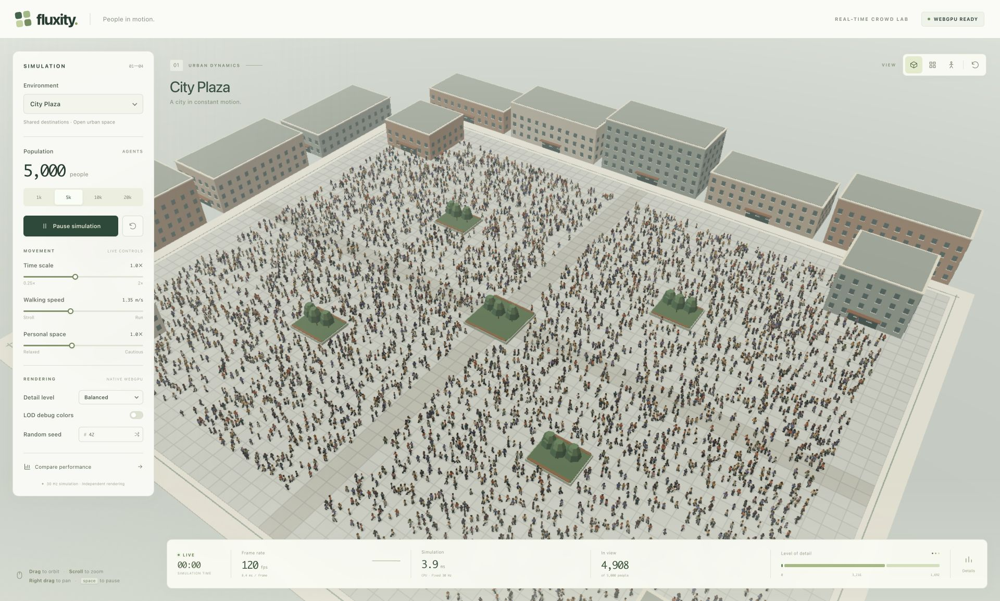

# Verification — 2026-11-17

## Automated checks

- `npm run typecheck`: passed (TypeScript strict).
- `npm test`: **50 tests passed across 9 files**, including the Shibuya/signal extension.
- `npm run build`: passed; Vite generated local HTML, CSS, main JavaScript and a separate simulation worker.

Tests cover deterministic seeds, finite state, speed/acceleration/turn limits, obstacle bounds, head-on passing, flow-field reachability, actual arrival through the bottleneck, all four supported population sizes, resting animation phases, snapshot layout, transferable ownership, buffer recycling, generation reset, pause/visibility handling, benchmark restoration, LOD hysteresis, frustum boundaries, mesh integrity, and WebGPU initialization failures.

## Browser verification

Actual native WebGPU rendering was verified in the Codex in-app desktop browser on macOS / arm64. This was an actual GPU canvas; there is no static-image or WebGL fallback.

Verified visually and through live DOM statistics:

- Default City Plaza with 5,000 moving articulated humans.
- Street view: identifiable heads, torsos, arms, legs, hair and shoes; independently phased walking.
- All four scenario selectors and their corresponding environment geometry.
- Pause/resume, reset, Space and R shortcuts.
- Population changes while paused, including 20,000 agents.
- Perspective / overhead / street presets, pointer-drag orbit, wheel zoom.
- Frustum compaction: zooming reduced the visible population to 155 while total population stayed 5,000.
- Quality and debug controls; three LOD statistics and diagnostic colors.
- Resize from desktop to a 390 × 844 CSS-pixel viewport and back, including panel collapse.
- Four-population benchmark completion and restoration of the original population and paused state.
- Actual **1920 × 1080 render target**, confirmed in the detailed statistics panel. The browser viewport was 1920 × 1154 to accommodate the 74-pixel app header.

Initial GPU testing exposed a derivative-uniformity WGSL error and coplanar floor/roof geometry. Both were corrected. The final browser error/warning log contained no new entries after those fixes.

Right-button panning is implemented and source-reviewed; the automated pointer interaction explicitly exercised orbit and wheel zoom. Physical GPU device loss was not forced; its reporting path is implemented. Other GPU/browser combinations were not tested.

## Shibuya and signal extension

The new default Shibuya-inspired scene was verified with an actual WebGPU canvas at 1440 × 1000 CSS viewport size and 5,000 pedestrians. The scene uses five shared zebra corridors, commercial buildings, and pedestrian signal fixtures.

- Manual Red after reset: at simulation time 00:14, the UI reported **670 waiting / 0 crossing**. The road remained clear.
- Manual Green without resetting: at simulation time 00:32, the UI reported approximately **1,900 crossing / 0 waiting**. Pedestrians entered all crossing routes, including the diagonal.
- While paused at 00:32, changing Green to Red updated the phase without advancing simulation time or resetting pedestrians.
- Returning to Auto while paused showed Green with 15 seconds remaining, consistent with the simulation-clock cycle; resuming restarted the countdown.
- The new scene and shader compiled and rendered successfully. The existing plaza and other scenarios remain covered by numeric and rendering tests.
- Switching back to City Plaza was also visually verified, with the signal controls hidden. The final Shibuya state was restored to Auto / 5,000 people, and the browser reported no warnings or errors.

During prolonged congestion at 5,000 people, one browser sample reported 53.7 ms per simulation step; a later final-version sample reported 10.8 ms. These are live observations, not a controlled browser benchmark. A bounded projection optimization removed redundant union-ray checks and closures, but its controlled same-state Node profile improved only about 2% (10.77 to 10.55 ms), so it does not establish that the browser slowdown is eliminated. Reducing population remains useful when the simulation falls behind its 33.33 ms budget.

Additional regression tests cover red entry prevention, green release, an existing crosser finishing after red, a waiting pedestrian yielding room, tangential movement along zebra/curb boundaries, opposite-corner arrival, deterministic signal state, 20,000-agent confinement, same-step signal snapshots while paused, and retrying a pending signal update after buffer-pool exhaustion.

The compact steering model can queue at exits under heavy density. A separate 1,000-agent numerical run reduced 623 crossers to 170 after 60 simulated red seconds and 17 after 120 seconds. This demonstrates continued clearing but is not a guarantee of complete clearance within one cycle. Shibuya's additional surface constraints also increase CPU cost; 20,000 people can exceed the 33.33 ms simulation budget. The City Plaza benchmarks below are not Shibuya performance measurements.

## Browser benchmark

City Plaza, seed 42, Perspective, Balanced, time scale 1×, walking speed 1.35 m/s, avoidance 1×. Each population used a **2-second warmup and 4-second sample**. These are observations on this machine, not a performance guarantee. FPS is measured from requestAnimationFrame intervals; simulation time is measured inside the worker. GPU execution time was **not measured**.

| People | FPS | Frame interval (ms) | CPU simulation step (ms) | Draw calls |
| ---: | ---: | ---: | ---: | ---: |
| 1,000 | 120.0 | 8.3 | 0.54 | 4 |
| 5,000 | 120.0 | 8.3 | 3.79 | 4 |
| 10,000 | 119.8 | 8.4 | 9.34 | 4 |
| 20,000 | 120.0 | 8.3 | 27.13 | 4 |

In this aerial view only two LOD batches were visible, giving four calls: environment, contact shadows, and two crowd batches. Views showing all three LODs use at most five calls. The renderer still culls agents outside the frustum; these results do not imply every agent uses the detailed mesh.

## CPU-only benchmark

`npm run benchmark`, Node v26.13.1, darwin arm64. City Plaza / seed 42; 30 warmup ticks and 120 measured ticks. Worker scheduling, transfer, and GPU rendering are excluded.

| People | Mean step (ms) | p95 step (ms) | Snapshot packing (ms) |
| ---: | ---: | ---: | ---: |
| 1,000 | 0.36 | 0.42 | 0.32 |
| 5,000 | 2.95 | 3.23 | 0.18 |
| 10,000 | 8.38 | 8.82 | 0.29 |
| 20,000 | 25.09 | 26.03 | 0.42 |

Separate 20,000-agent / 120-step numerical runs for all scenarios found no obstacle penetration. Those short runs do not guarantee behavior at arbitrary density or after indefinite accumulation at an exit.

## Visual records

