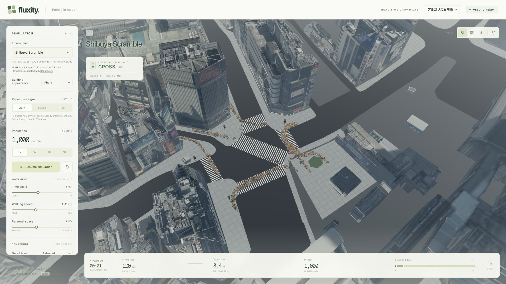
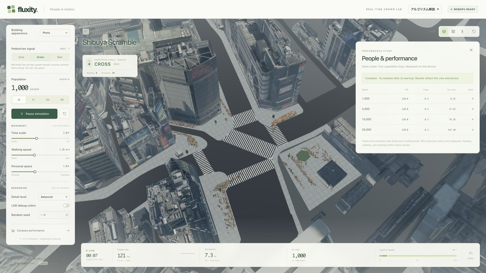
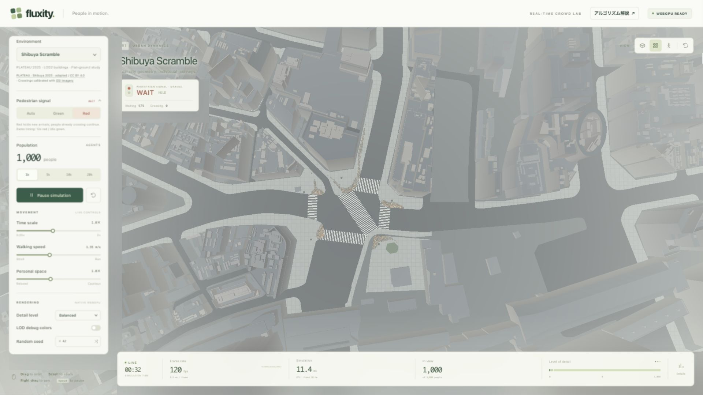
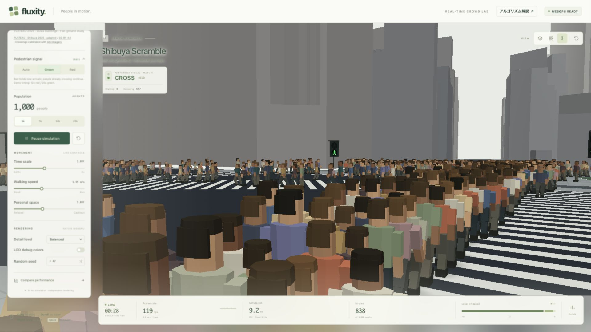
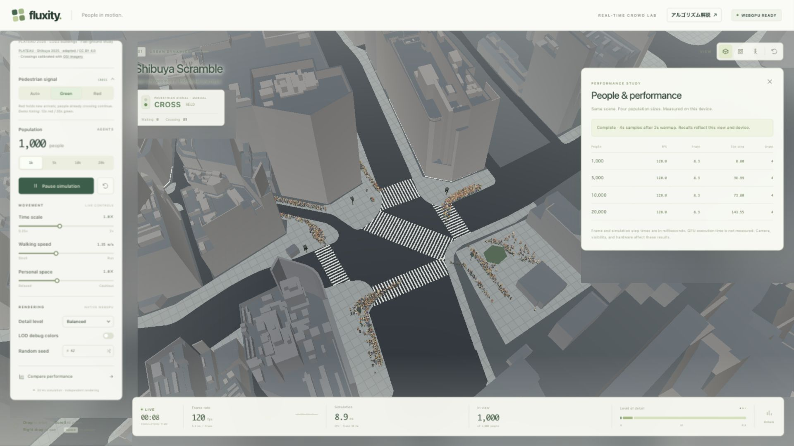
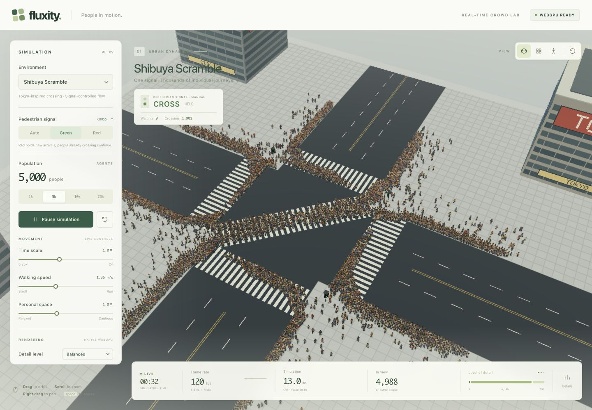
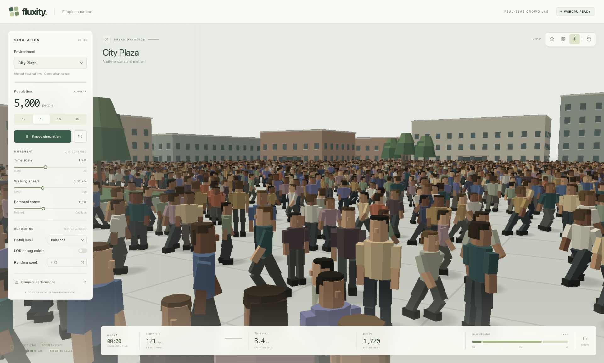

# 渋谷の店舗前で間隔を空け、戸口から出る人に道を譲る（2026-11-25）

渋谷で1,000人、自動信号、歩行速度1.35 m/s、回避強度1に設定した。比較対象は、出入口で歩行者同士が譲り合う機能をすでに備えた `1474138`。

## 18分29秒まで動かしたときの流れ

通常の初期配置から開始し、12〜17分の5分間に各店舗へ入れた件数を数えた。以下はすべて旧版 → 新版。

| シード | 北西店 | 北店 | 東店 | 広場前店 | 南西店 |
| --- | ---: | ---: | ---: | ---: | ---: |
| 42 | 9 → 201 | 16 → 160 | 69 → 134 | 59 → 152 | 77 → 158 |
| 7 | 3 → 189 | 13 → 156 | 81 → 153 | 76 → 168 | 124 → 158 |
| 137 | 0 → 179 | 67 → 0 | 70 → 122 | 66 → 142 | 111 → 137 |

添付画面と同じ18分29秒時点で、目的の店舗の戸口から12 m以内の歩道に5分以上連続でいた人を数えた。滞在は1秒間隔で観測した。北店・東店・広場前店の該当者は両版とも0人だった。

| シード | 北西店の5分以上滞在（人） | 南西店の5分以上滞在（人） | 開始からの全目的地への到着（件） |
| --- | ---: | ---: | ---: |
| 42 | 180 → 18 | 11 → 0 | 2,103 → 3,255 |
| 7 | 176 → 47 | 0 → 0 | 2,313 → 3,272 |
| 137 | 181 → 16 | 0 → 76 | 2,206 → 2,740 |

北西店は3条件とも入店が続いた。シード137では南西店の長時間滞在が増え、北店では観測した5分間の入店が0件だった。この条件では5店舗の流れに偏りが残る。

通常起動の計測は各版で以下を実行して再現できる。`doors[].intervals` 内の `endSecond` が780、840、900、960、1020の `entered` を合計する。終了時の滞在人数は各店舗の `endOwnShopDwell300s12m` で確認できる。

```sh
node --import tsx scripts/measure-shibuya-flow.ts 42 1109
node --import tsx scripts/measure-shibuya-flow.ts 7 1109
node --import tsx scripts/measure-shibuya-flow.ts 137 1109
```

## すでに動けなくなった人のうち、何人が入店できたか

シード42を旧版の動作で5分間進め、北西店を目的地とし、戸口から12 m以内で5秒を超えて足止めされていた歩行者116人を記録した。全員がまだ店の通路に入る前だった。同じ位置・速度・向き・目的地から、一方では旧版を続け、もう一方ではその時点で新しい動作を有効にした。各人がその旅程を終えて入店した回数を人物IDと世代で追った。

| 観察時間 | 旧版で入店できた人数 | 新しい動作で入店できた人数 |
| --- | ---: | ---: |
| 次の2分間 | 0 / 116 | 22 / 116 |
| 次の5分間 | 1 / 116 | 68 / 116 |

## 横断者が歩道に上がれるか

赤信号に切り替え、その時すでに横断中だった人が全身を歩道に戻すまでを計測した。シード42は458人全員が36.10秒、137は468人全員が46.43秒、早めに赤へ変えた42は131人全員が17.50秒で歩道に到達した。どの条件でも、赤を維持した120秒間に新しく車道へ入った人は0人だった。

# 渋谷の出入口での譲り合い（2026-11-25）

1,000人、自動信号、歩行速度1.35 m/s、回避強度1で、譲り合いを導入する前（`6e47fbd`）と導入後を比べた。地図と戸口の幅を揃え、各シードで通常の初期配置から17分46秒まで実行した。

| シード | 12〜17分に目的地に着いた件数（前 → 後） | 17分46秒時点で店舗前に5分以上いた人数（前 → 後） |
| --- | ---: | ---: |
| 42 | 49 → 230 | 386 → 188 |
| 7 | 32 → 314 | 451 → 176 |
| 137 | 15 → 334 | 457 → 182 |

到着は5店舗と北の街路端の全6地点で旅程を完了した回数。滞留は、同じ人が目的の店舗の戸口から12 m以内の歩道に居続けた時間を1秒ごとに測った。北西店では滞留が残り、シード42・7・137の順に、167人から179人、153人から176人、172人から182人に増えた。

すでに混雑した出入口でも試した。シード42で10分まで旧方式で動かし、目的の店舗前にすでに1分以上いた386人を追跡した。同じ位置、速度、旅程から次の5分間に入店できた人数は、旧方式を続けると0人、その時点で譲り合いを有効にすると232人だった。

通常起動の計測は以下で再現できる。`allPortalArrivals.intervals` の終了秒が780〜1020の5区間を合計すると表の到着件数、`doors` の `endOwnShopDwell300s12m` を合計すると滞留人数になる。

```sh
node --import tsx scripts/measure-shibuya-flow.ts 42 1066
node --import tsx scripts/measure-shibuya-flow.ts 7 1066
node --import tsx scripts/measure-shibuya-flow.ts 137 1066
```

# 渋谷の横断幅と店舗前の滞留（2026-11-25）

渋谷デモの開始2分26秒まで、同じ1,000人・シード42・自動信号・歩行速度1.35 m/s・回避強度1で変更前後を比較した。シミュレーションは毎秒30ステップ。比較図の点はその時刻の実座標、棒は開始からの累積通過位置を示す。[変更前後の比較図](screenshots/shibuya-flow-comparison.png)・[デモの俯瞰画面](screenshots/shibuya-crosswalk-width.jpg)

## 横断歩道のどこを歩いたか

各人が横断歩道の長さの中点を初めて越えた瞬間の横位置を記録した。表の幅は横位置の10パーセンタイルから90パーセンタイルまでの距離を、白線の幅で割ったもの。5本とも変更後は幅を5等分した全区画で通過を観測した。

| 横断歩道 | 通過人数（変更前 → 変更後） | 中央80%の歩行者が使った幅（変更前 → 変更後） |
| --- | ---: | ---: |
| 西 | 197 → 154 | 67.3% → 67.9% |
| 南 | 480 → 474 | 71.6% → 68.6% |
| 東 | 475 → 514 | 72.5% → 71.4% |
| 北 | 13 → 87 | 6.3% → 76.6% |
| 斜め | 178 → 279 | 31.8% → 67.6% |

北側は従来、初期の行き先に通行需要がほとんどなかった。北と東の各出発地区で5人に1人の割合を互いの地区へ向かう旅程に振り替えた。各地区から交差点を渡る旅程と近隣の店舗へ向かう旅程の比率は4対1。回帰テストでは出発位置と目的地を固定し、すれ違い回避を外しても幅の5区画すべてを通ることを確認した。

## 店舗への入場と店舗からの出場

5店舗の戸口から6 m・12 m以内の歩道で、直前1秒の変位が0.35 m未満の人を毎秒数え、61〜146秒で平均した。入場はその店舗の奥まで歩いた時点、出場はその店舗から歩道に合流した時点で別々に数えた。北の通りとの出入りは店舗の集計から除いた。

| 条件 | 6 m以内の低速人数（平均） | 12 m以内の低速人数（平均） | 146秒間の入場 | 146秒間の出場 |
| --- | ---: | ---: | ---: | ---: |
| シード42・変更前 | 96.81 | 285.08 | 165 | 137 |
| シード42・変更後 | 14.77 | 41.90 | 428 | 372 |
| シード7・変更前 | 47.63 | 187.92 | 158 | 139 |
| シード7・変更後 | 18.13 | 54.58 | 396 | 335 |

シード42の146秒時点では、6 m以内の低速人数が106人から24人になった。5分間の合計でも入場が327人から895人、出場が318人から780人に増えた。変更前は北の店舗が最後の1分間に入場・出場とも0人だった。変更後は同じ1分に5店舗すべてで入場があり、北の店舗では27人が入り25人が出た。南西店は入場40人・出場0人だった。この1分は新しい歩行者の出場口に南西店が選ばれず、開始時と終了時に店内で出場待ちの人は0人だった。5分時点の6 m以内の低速人数は南西店47人、北西店46人だった。

固定赤も同じ実装で確認した。最初の青の終わりに赤に固定した場合、シード42は441人が81.17秒、シード137は495人が46.30秒で全員歩道へ着いた。赤60秒後の残りはそれぞれ4人と0人。シード42の最後の4人は駅前側の縁石で、踏み出した直後に元の歩道へ引き返す途中、待機列の通過に時間がかかった。シード42で青の途中に切り替えた場合は136人が17.70秒で全員退避した。3条件とも赤の120秒間に新しく横断を始めた人は0人だった。

```sh
node --import tsx scripts/measure-shibuya-flow.ts 42
node --import tsx scripts/measure-shibuya-flow.ts 7
node --import tsx scripts/measure-shibuya-flow.ts 42 300
```

# 渋谷の赤信号での横断完了（2026-11-25）

1,000人、歩行速度1.35 m/s、回避強度1で開始し、最初の青の最終ステップ（46.97秒）で赤に固定した。切り替え時に横断中だった人を、同じ人物が全身で歩道に入るまで追跡した。各ステップで画面用の横断人数と照合し、赤で新しく歩道を離れた人数も数えた。

| 赤で経過したシミュレーション秒数 | シード42・修正前 | シード42・修正後 | シード137・修正後 |
| --- | ---: | ---: | ---: |
| 0 | 547 | 546 | 612 |
| 12 | 391 | 241 | 265 |
| 30 | 194 | 36 | 49 |
| 60 | 111 | 0 | 0 |
| 120 | 42 | 0 | 0 |

修正後の全員が歩道に達した時刻は、赤からそれぞれ49.97秒と51.27秒。いずれも赤での新規進入は0人だった。シード42で開始人数が1人減ったのは、建物際の歩道にいた人の座標が戸口での移動制限後に丸められ、横断中に数えられていたため。この座標の保存も修正した。

別途、切り替え直前まで旧版の戸口・境界処理を使い、元の547人の位置・速度・旅程・入口の一致を確認してから新しい赤信号処理に切り替えた。この再生では赤12秒後に243人、30秒後に39人が残り、50.57秒で全員が有効な歩道に入った。120秒間の新規進入は0人。人物の入れ替わりは横断完了に含めていない。

青の途中で赤にした場合も確認した。シード42の485ステップ目（開始16.17秒）では、引き返す人の前に待機列ができる。修正後は132人が赤から16.87秒で歩道に到着し、120秒間の新規進入は0人だった。ブラウザーでも手動赤で全員が歩道に戻り、画面の横断人数が0になることを確認した。[確認画面](screenshots/crossing-clearance-red.jpg)

```sh
node --import tsx scripts/check-crossing-clearance.ts
node --import tsx scripts/check-crossing-clearance.ts 137
node --import tsx scripts/check-crossing-clearance.ts 42 485
```

# 歩行者の視線・迷い・回避の変更前後比較（2026-11-25）

渋谷の1,000人を、赤12秒・青35秒の最初の1周期（1,410ステップ）にわたり追跡した。比較元は `fe0cb5d`。歩行速度1.35 m/s、回避強度1、固定30 Hzを共通にした。シードごとに初期位置、速度、目的地、外観、身体半径などのSHA-256を照合した。行動の追加で従来の初期配置用乱数を消費しないため、同じ人物・同じ出発地点から比較できる。

## 最初の信号1周期

| 指標 | シード42・変更前 | シード42・変更後 | シード137・変更前 | シード137・変更後 |
| --- | ---: | ---: | ---: | ---: |
| 青の間に別の歩道まで渡り切った人数 | 256 | 224 | 272 | 203 |
| 赤で車道に新規進入した人数 | 0 | 0 | 0 | 0 |
| 身体が接触した回数（組単位） | 1,566 | 642 | 2,215 | 935 |
| 同じ対向者に対する左右の切り返し | 321 | 289 | 303 | 284 |
| 信号待ちで注視を始めた回数 | 0 | 22 | 0 | 47 |
| 分岐で足をゆるめた回数 | 0 | 7 | 0 | 6 |
| 頭が胴体から15度以上横を向いた合計（人・秒） | 0 | 612.97 | 0 | 580.27 |
| 上体を引いた回数（人物単位） | 0 | 422 | 0 | 501 |
| 待機人数の最大値 | 129 | 117 | 148 | 135 |
| 平均歩行速度（m/s） | 0.922 | 0.874 | 0.957 | 0.906 |

シード42では、回避後まで減速を引きずった初期案の横断完了が157人だった。減速量を予測した接近度に合わせ、相手が進路を外れたら解除する設定を採用した。最終版では変更前に比べて接触が59.0%、切り返しが10.0%、横断完了が12.5%減った。調整に使わなかったシード137でも接触が57.8%、切り返しが6.3%減ったが、横断完了の減少幅は25.4%だった。これらは最初の青が終わるまでの測定値であり、長時間の通過能力や実際の渋谷の流量は検証していない。

初期状態のSHA-256は変更前後で一致した。

- シード42　`63f5b5613a5d27e3ad699d76e5a926d80ebcce842cfe20082b2671b785500300`
- シード137　`d43cc9645746a31dc07789fcea95b509a7731ed439fde4e6099039d051c4119e`

## 指標の読み方

- **横断完了**は、歩道を出て別の歩道ポリゴンに到達した時点で青だった通過を数える。同じ縁石へ戻った場合や、青終了時にまだ渡っている人は含めない。
- **接触**は、通常歩行中の2人が身体半径の和まで接近し、接近速度が0.10 m/s以上だったときに1組1回と数える。再集計には5 cm以上の分離を要求する。初期配置の重なりを除き、回避アルゴリズムとは独立に軌跡から計算した。**上体を引く反応**は接近速度と周囲との継続接触を考慮して人物単位で数える。
- **左右の切り返し**は、1.8 m以内の同じ対向者との遭遇中に、希望進路に対する横速度が1秒以内に逆向きへ0.20 m/s以上変わった回数。両側で横速度の絶対値が0.20 m/s以上、前後の希望進路の内積が0.95以上となる場合に集計した。
- **信号待ちの注視と分岐での迷い**は行動の開始回数。迷いは、同じ目的地に通じる二方向の道のりが近いときにだけ起こる。頻度と持続時間はデモ用の調整値である。

## CPUの更新時間

macOS arm64、Node v26.13.1（Homebrew `26.13.1_4` の同一バイナリ）で両版を順に測定した。シード42・自動信号で、人数ごとに30ステップのウォームアップ後に120ステップを計測した。この区間は開始後約1〜5秒の赤信号にあたる。単位はms/ステップ。描画、Worker転送、スナップショット作成は計測外。テストやブラウザでのシミュレーションは同時実行していない。

| 人数 | 平均・変更前 | 平均・変更後 | p95・変更前 | p95・変更後 |
| ---: | ---: | ---: | ---: | ---: |
| 1,000 | 8.44 | 8.33 | 9.03 | 8.78 |
| 5,000 | 49.00 | 50.91 | 50.83 | 52.66 |
| 10,000 | 98.74 | 99.55 | 103.26 | 103.03 |
| 20,000 | 186.62 | 189.85 | 191.91 | 194.50 |

別途、1,000人の**青信号35秒全体**（1,050ステップ）で `Simulation.step()` を計測した。平均は **7.36 → 7.58 ms**、p95は **7.79 → 8.07 ms**。観測用の接触・横断の集計は各ステップの計時終了後に実行した。1条件1回の比較なので小さな差には計時のばらつきも含まれる。この端末で30 Hzの予算（33.33 ms）を満たした人数設定は1,000人だった。

首と上体の追加でWorkerのスナップショットは1人52 → 60バイトになり、2万人で1回あたり160,000バイト増えた。GPUのインスタンスは1人64バイトで、既存の描画呼び出しで両方の姿勢を反映する。

## 自動検証と再現手順

最終版で `npm test` の21ファイル・130件と、型検査を含む `npm run build` が成功した。テストは信号と歩行領域の制約、すれ違い時の距離、接触反応の再発火、分岐の判定、個人ごとの視線、人物入れ替え時の描画補間を含む。

変更前のソースでは、今回の `scripts/compare-crowd.ts` を同じ相対パスにコピーする。同じ依存関係とNodeバイナリを使い、両方のディレクトリで以下を実行する。

```sh
node --import tsx scripts/compare-crowd.ts --seed=42
node --import tsx scripts/compare-crowd.ts --seed=137
node --import tsx scripts/benchmark.ts --scenario=shibuya --signal=auto --steps=120 --counts=1000,5000,10000,20000
```

回避係数の最終調整前に、本番ビルドのWebGPUストリート視点で頭・胴・足の表示を確認した。手動の赤で歩道に人が集まり、青への切り替え後に横断を開始した。表示中のブラウザコンソールに警告・エラーはなかった。[信号待ち](screenshots/pedestrian-attention.jpg)・[青に切り替えた直後](screenshots/pedestrian-encounters.jpg)

---

# Verification — photographic buildings, 2026-11-18

- `npm test`: **87 tests passed across 13 files**; `npm run build` passed including strict TypeScript checking.
- Python conversion tests: **13 passed**, including matching geometry/UV deduplication, closed rings, holes, V-axis conversion, reversed triangles, atlas packing and rejection of changed source-image hashes.
- Every one of the **440 buildings** has photo-mapped surfaces. The selected source geometry has **46,173 textured polygons out of 53,381**; remaining ground/installation surfaces retain material colors.
- **1,606 source JPEGs** (23,604,861 bytes) become **five 2048 × 2048 atlases**, totaling 6,084,655 bytes. The UV/page stream is 2,664,204 bytes. Mesh, coordinates and photographs total **19,016,523 bytes** before HTTP compression, excluding the smaller navigation JSON.
- GPU atlas allocation including mipmaps is **111,848,100 bytes (106.67MiB)**, within the 128MiB texture budget. This is GPU allocation, not download size; geometry, crowd and framebuffer resources are additional.
- Removing the new `appearance` metadata from the map produces the same map as the prior geometry-only version. Geometry buffer hashes, navigation polygons, crossing layout and simulation behavior are unchanged.
- An offline rebuild checked all 1,606 source-image hashes against the manifest and reproduced all ten output files byte-for-byte (geometry, UV, five atlases, manifest and map JSON).

The production build was verified at `/fluxity/` in the native WebGPU browser. Photo and Solid both rendered; changing appearance while paused kept the same crowd and clock state. Street and perspective views showed correctly oriented wall photographs, signs and roof details. Switching to City Plaza hid the photo control; returning to Shibuya restored the photos successfully from cached source data. Native shader compilation and mip generation completed without warnings or errors.

Tests also cover corrupted UV/atlas hashes, invalid UV/page assignments, triangle page consistency, atlas dimensions and allocation limits, every mip/layer, scene changes during decoding, partial decode failure, and bitmap/buffer/texture cleanup. Images are cached as compressed Blobs; closed ImageBitmaps are never reused. One environment draw call is retained.

The photos are from the source dataset and may show older signs or construction. Resolution is deliberately reduced outside the crossing area. Photography already contains lighting and occlusion, so it is only lightly shaded in the renderer; this is not a uniformly lit photogrammetric model.

The browser benchmark used the same device and settings as the earlier geometry comparison: **1920 × 1080 viewport / 1920 × 1006 canvas**, Balanced, Perspective, Photo, seed 42, Green held, 1× time, 1.35m/s walking speed and 1× avoidance. Each condition had 2 seconds of warmup and 4 seconds of sampling. No importer or test suite ran concurrently.

| People | FPS | Frame interval (ms) | CPU simulation step (ms) | Draw calls |
| ---: | ---: | ---: | ---: | ---: |
| 1,000 | 120.0 | 8.3 | 8.32 | 4 |
| 5,000 | 120.0 | 8.3 | 37.92 | 4 |
| 10,000 | 120.0 | 8.3 | 76.35 | 4 |
| 20,000 | 120.0 | 8.3 | 147.10 | 4 |

Rendering and simulation are independent. These short observations do not imply 30Hz simulation at large populations, a measured GPU execution time, or performance on other devices. A separate paused check at **00:21 / 448 crossing** retained both values through Solid → Photo.






---

# Verification — initial PLATEAU geometry update, 2026-11-18

The following measurements were made before photographic appearance was added.

## Automated checks

- `npm test`: **76 tests passed across 12 files**.
- `npm run build`: passed, including strict TypeScript checking.
- Python conversion tests: **6 passed** with Python 3.9 and the pinned requirements.
- Generated asset SHA-256 values match the map metadata. The scenery contains **440 buildings, all LOD2**, 222,017 vertices and 115,582 triangles. Vertex/index buffers total **10,267,664 bytes**; the navigation JSON is about 186 KB.

New coverage includes real-map destination connectivity, valid sidewalk spawning for 20,000 people, 1,000 pedestrians staying on sidewalks through 120 red-signal steps and beginning crossings through 180 green steps, repeated five-zone arrivals, and bounded local avoidance work. Polygon tests include holes, concave boundaries, swept movement, tangential sliding and crossing exits during red. A Float32 regression checks that storage rounding cannot turn a curb-side waiter into a crosser or freeze sliding along the boundary. Loader tests cover base-relative URLs, byte counts, normals, indices, SHA-256 mismatch/retry and stale asynchronous scenario loads.

The converter checks coordinate axes and scale, concave/holed faces, vertical walls, LOD2 references and surface orientation. It omits 105 submillimetric degenerate triangles after Float32 conversion; maximum original-face planarity deviation is 0.029164m. Source XML, calibrated layout and output hashes are recorded in the data manifest.

## Browser verification and benchmark

The production build was served at `http://127.0.0.1:4173/fluxity/`, matching a GitHub Pages subpath. The native WebGPU canvas, Worker and binary data loaded successfully. The final browser error/warning log was empty.

- Manual Red after reset: at 22 simulated seconds the UI showed **424 waiting / 0 crossing**.
- Changing to Green without reset released the waiting flows; street view later showed **463 crossing**.
- Perspective, overhead and street views rendered the LOD2 buildings, flat road surfaces, five painted crossing corridors and signal fixtures. No overlapping road/paint flicker was visible after the ground mesh was divided into disjoint faces.
- City Plaza loaded with the map credits and signal controls hidden; returning to Shibuya restored the real scenery and signal controls. The final state was restored to **1,000 people / Auto / Perspective**.

The browser comparison used macOS arm64, the Codex in-app desktop browser, seed 42, Green held, Perspective, Balanced, time scale 1×, walking speed 1.35m/s and avoidance 1×. The CSS viewport was **1920 × 1080**, with an actual **1920 × 1006 canvas** below the header. Each population had a 2-second warmup and 4-second sample. GPU execution time was not measured.

| People | FPS | Frame interval (ms) | CPU simulation step (ms) | Draw calls |
| ---: | ---: | ---: | ---: | ---: |
| 1,000 | 120.0 | 8.3 | 8.80 | 4 |
| 5,000 | 120.0 | 8.3 | 36.99 | 4 |
| 10,000 | 120.0 | 8.3 | 73.80 | 4 |
| 20,000 | 120.0 | 8.3 | 141.55 | 4 |

The renderer interpolates independently of the simulation. High FPS therefore does **not** mean the CPU maintained 30 simulation steps per wall-clock second. This is a short measurement on one device and view, including frustum culling and crowd LOD.








## CPU benchmark

`npm run benchmark:shibuya`, Node v26.13.1 / darwin arm64, seed 42, Green held, 30 warmup steps plus 60 measured steps. Browser simulation was paused, and no test suite ran concurrently. Rendering, Worker scheduling and transfer are excluded.

| People | Mean step (ms) | p95 step (ms) | Snapshot packing (ms) |
| ---: | ---: | ---: | ---: |
| 1,000 | 6.90 | 7.18 | 0.38 |
| 5,000 | 39.68 | 40.62 | 0.27 |

The 5,000-person workload exceeds the 33.33ms budget for 30Hz simulation on this machine. The default is therefore 1,000 people; larger populations remain available for experimentation.

## Scope and limits

The visible scenery covers approximately 500m square; walking is limited to 250m square. Ground is flattened, buildings are untextured, and crossing/plaza corrections are calibrated overlays. The FY2025 source includes older geometry and attributes; it is not a current construction survey. Traffic timing remains the demo's 12-second red / 35-second green cycle. Numeric and short browser tests do not establish unlimited-duration clearance under heavy congestion, physical non-overlap of people, or performance on other hardware.

---

# Historical verification — 2026-11-17, before PLATEAU

The following records describe the earlier procedural scenes and are retained for comparison. Their Shibuya geometry and performance are not measurements of the PLATEAU update.

## Automated checks

- `npm run typecheck`: passed (TypeScript strict).
- `npm test`: **50 tests passed across 9 files**, including the Shibuya/signal extension.
- `npm run build`: passed; Vite generated local HTML, CSS, main JavaScript and a separate simulation worker.

Tests cover deterministic seeds, finite state, speed/acceleration/turn limits, obstacle bounds, head-on passing, flow-field reachability, actual arrival through the bottleneck, all four supported population sizes, resting animation phases, snapshot layout, transferable ownership, buffer recycling, generation reset, pause/visibility handling, benchmark restoration, LOD hysteresis, frustum boundaries, mesh integrity, and WebGPU initialization failures.

## Browser verification

Actual native WebGPU rendering was verified in the Codex in-app desktop browser on macOS / arm64. This was an actual GPU canvas; there is no static-image or WebGL fallback.

Verified visually and through live DOM statistics:

- Default City Plaza with 5,000 moving articulated humans.
- Street view: identifiable heads, torsos, arms, legs, hair and shoes; independently phased walking.
- All four scenario selectors and their corresponding environment geometry.
- Pause/resume, reset, Space and R shortcuts.
- Population changes while paused, including 20,000 agents.
- Perspective / overhead / street presets, pointer-drag orbit, wheel zoom.
- Frustum compaction: zooming reduced the visible population to 155 while total population stayed 5,000.
- Quality and debug controls; three LOD statistics and diagnostic colors.
- Resize from desktop to a 390 × 844 CSS-pixel viewport and back, including panel collapse.
- Four-population benchmark completion and restoration of the original population and paused state.
- Actual **1920 × 1080 render target**, confirmed in the detailed statistics panel. The browser viewport was 1920 × 1154 to accommodate the 74-pixel app header.

Initial GPU testing exposed a derivative-uniformity WGSL error and coplanar floor/roof geometry. Both were corrected. The final browser error/warning log contained no new entries after those fixes.

Right-button panning is implemented and source-reviewed; the automated pointer interaction explicitly exercised orbit and wheel zoom. Physical GPU device loss was not forced; its reporting path is implemented. Other GPU/browser combinations were not tested.

## Shibuya and signal extension

The new default Shibuya-inspired scene was verified with an actual WebGPU canvas at 1440 × 1000 CSS viewport size and 5,000 pedestrians. The scene uses five shared zebra corridors, commercial buildings, and pedestrian signal fixtures.

- Manual Red after reset: at simulation time 00:14, the UI reported **670 waiting / 0 crossing**. The road remained clear.
- Manual Green without resetting: at simulation time 00:32, the UI reported approximately **1,900 crossing / 0 waiting**. Pedestrians entered all crossing routes, including the diagonal.
- While paused at 00:32, changing Green to Red updated the phase without advancing simulation time or resetting pedestrians.
- Returning to Auto while paused showed Green with 15 seconds remaining, consistent with the simulation-clock cycle; resuming restarted the countdown.
- The new scene and shader compiled and rendered successfully. The existing plaza and other scenarios remain covered by numeric and rendering tests.
- Switching back to City Plaza was also visually verified, with the signal controls hidden. The final Shibuya state was restored to Auto / 5,000 people, and the browser reported no warnings or errors.

During prolonged congestion at 5,000 people, one browser sample reported 53.7 ms per simulation step; a later final-version sample reported 10.8 ms. These are live observations, not a controlled browser benchmark. A bounded projection optimization removed redundant union-ray checks and closures, but its controlled same-state Node profile improved only about 2% (10.77 to 10.55 ms), so it does not establish that the browser slowdown is eliminated. Reducing population remains useful when the simulation falls behind its 33.33 ms budget.

Additional regression tests cover red entry prevention, green release, an existing crosser finishing after red, a waiting pedestrian yielding room, tangential movement along zebra/curb boundaries, opposite-corner arrival, deterministic signal state, 20,000-agent confinement, same-step signal snapshots while paused, and retrying a pending signal update after buffer-pool exhaustion.

The compact steering model can queue at exits under heavy density. A separate 1,000-agent numerical run reduced 623 crossers to 170 after 60 simulated red seconds and 17 after 120 seconds. This demonstrates continued clearing but is not a guarantee of complete clearance within one cycle. Shibuya's additional surface constraints also increase CPU cost; 20,000 people can exceed the 33.33 ms simulation budget. The City Plaza benchmarks below are not Shibuya performance measurements.




## Browser benchmark

City Plaza, seed 42, Perspective, Balanced, time scale 1×, walking speed 1.35 m/s, avoidance 1×. Each population used a **2-second warmup and 4-second sample**. These are observations on this machine, not a performance guarantee. FPS is measured from requestAnimationFrame intervals; simulation time is measured inside the worker. GPU execution time was **not measured**.

| People | FPS | Frame interval (ms) | CPU simulation step (ms) | Draw calls |
| ---: | ---: | ---: | ---: | ---: |
| 1,000 | 120.0 | 8.3 | 0.54 | 4 |
| 5,000 | 120.0 | 8.3 | 3.79 | 4 |
| 10,000 | 119.8 | 8.4 | 9.34 | 4 |
| 20,000 | 120.0 | 8.3 | 27.13 | 4 |

In this aerial view only two LOD batches were visible, giving four calls: environment, contact shadows, and two crowd batches. Views showing all three LODs use at most five calls. The renderer still culls agents outside the frustum; these results do not imply every agent uses the detailed mesh.


## CPU-only benchmark

`npm run benchmark`, Node v26.13.1, darwin arm64. City Plaza / seed 42; 30 warmup ticks and 120 measured ticks. Worker scheduling, transfer, and GPU rendering are excluded.

| People | Mean step (ms) | p95 step (ms) | Snapshot packing (ms) |
| ---: | ---: | ---: | ---: |
| 1,000 | 0.36 | 0.42 | 0.32 |
| 5,000 | 2.95 | 3.23 | 0.18 |
| 10,000 | 8.38 | 8.82 | 0.29 |
| 20,000 | 25.09 | 26.03 | 0.42 |

Separate 20,000-agent / 120-step numerical runs for all scenarios found no obstacle penetration. Those short runs do not guarantee behavior at arbitrary density or after indefinite accumulation at an exit.

## Visual records



