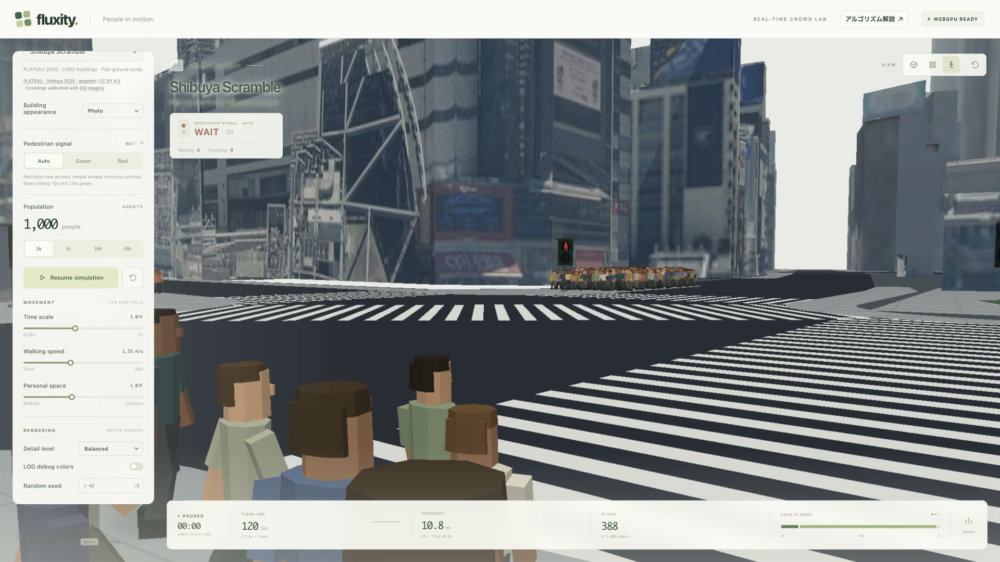
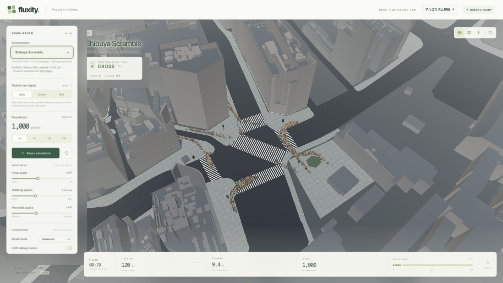
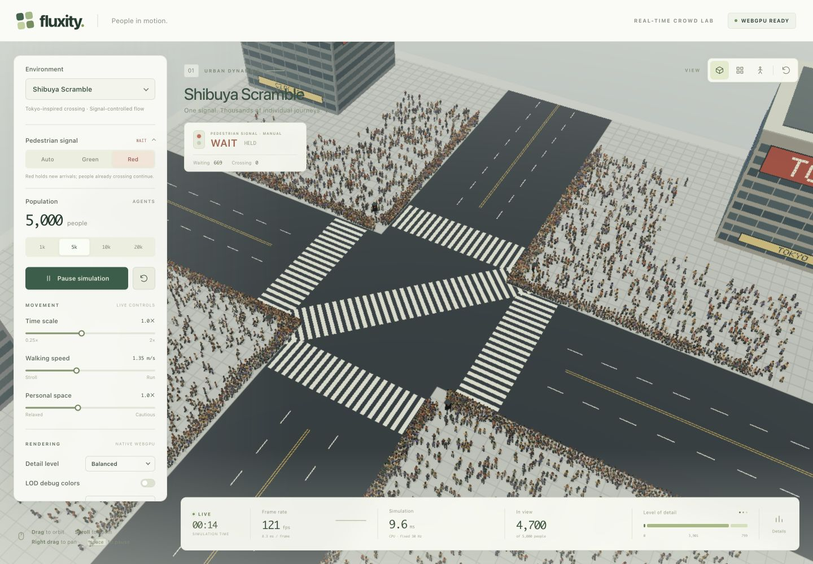
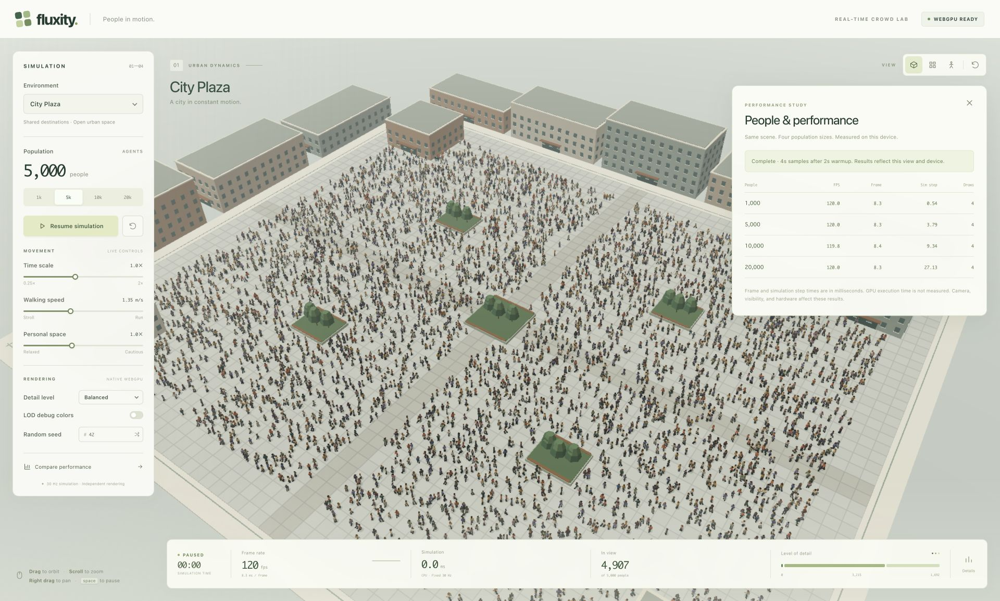

# Verification — photographic buildings, 2026-11-18

- `npm test`: **87 tests passed across 13 files**; `npm run build` passed including strict TypeScript checking.
- Python conversion tests: **13 passed**, including matching geometry/UV deduplication, closed rings, holes, V-axis conversion, reversed triangles, atlas packing and rejection of changed source-image hashes.
- Every one of the **440 buildings** has photo-mapped surfaces. The selected source geometry has **46,173 textured polygons out of 53,381**; remaining ground/installation surfaces retain material colors.
- **1,606 source JPEGs** (23,604,861 bytes) become **five 2048 × 2048 atlases**, totaling 6,084,655 bytes. The UV/page stream is 2,664,204 bytes. Mesh, coordinates and photographs total **19,016,523 bytes** before HTTP compression, excluding the smaller navigation JSON.
- GPU atlas allocation including mipmaps is **111,848,100 bytes (106.67MiB)**, within the 128MiB texture budget. This is GPU allocation, not download size; geometry, crowd and framebuffer resources are additional.
- Removing the new `appearance` metadata from the map produces the same map as the prior geometry-only version. Geometry buffer hashes, navigation polygons, crossing layout and simulation behavior are unchanged.
- An offline rebuild checked all 1,606 source-image hashes against the manifest and reproduced all ten output files byte-for-byte (geometry, UV, five atlases, manifest and map JSON).

The production build was verified at `/fluxity/` in the native WebGPU browser. Photo and Solid both rendered; changing appearance while paused kept the same crowd and clock state. Street and perspective views showed correctly oriented wall photographs, signs and roof details. Switching to City Plaza hid the photo control; returning to Shibuya restored the photos successfully from cached source data. Native shader compilation and mip generation completed without warnings or errors.

Tests also cover corrupted UV/atlas hashes, invalid UV/page assignments, triangle page consistency, atlas dimensions and allocation limits, every mip/layer, scene changes during decoding, partial decode failure, and bitmap/buffer/texture cleanup. Images are cached as compressed Blobs; closed ImageBitmaps are never reused. One environment draw call is retained.

The photos are from the source dataset and may show older signs or construction. Resolution is deliberately reduced outside the crossing area. Photography already contains lighting and occlusion, so it is only lightly shaded in the renderer; this is not a uniformly lit photogrammetric model.

The browser benchmark used the same device and settings as the earlier geometry comparison: **1920 × 1080 viewport / 1920 × 1006 canvas**, Balanced, Perspective, Photo, seed 42, Green held, 1× time, 1.35m/s walking speed and 1× avoidance. Each condition had 2 seconds of warmup and 4 seconds of sampling. No importer or test suite ran concurrently.

| People | FPS | Frame interval (ms) | CPU simulation step (ms) | Draw calls |
| ---: | ---: | ---: | ---: | ---: |
| 1,000 | 120.0 | 8.3 | 8.32 | 4 |
| 5,000 | 120.0 | 8.3 | 37.92 | 4 |
| 10,000 | 120.0 | 8.3 | 76.35 | 4 |
| 20,000 | 120.0 | 8.3 | 147.10 | 4 |

Rendering and simulation are independent. These short observations do not imply 30Hz simulation at large populations, a measured GPU execution time, or performance on other devices. A separate paused check at **00:21 / 448 crossing** retained both values through Solid → Photo.

---

# Verification — initial PLATEAU geometry update, 2026-11-18

The following measurements were made before photographic appearance was added.

## Automated checks

- `npm test`: **76 tests passed across 12 files**.
- `npm run build`: passed, including strict TypeScript checking.
- Python conversion tests: **6 passed** with Python 3.9 and the pinned requirements.
- Generated asset SHA-256 values match the map metadata. The scenery contains **440 buildings, all LOD2**, 222,017 vertices and 115,582 triangles. Vertex/index buffers total **10,267,664 bytes**; the navigation JSON is about 186 KB.

New coverage includes real-map destination connectivity, valid sidewalk spawning for 20,000 people, 1,000 pedestrians staying on sidewalks through 120 red-signal steps and beginning crossings through 180 green steps, repeated five-zone arrivals, and bounded local avoidance work. Polygon tests include holes, concave boundaries, swept movement, tangential sliding and crossing exits during red. A Float32 regression checks that storage rounding cannot turn a curb-side waiter into a crosser or freeze sliding along the boundary. Loader tests cover base-relative URLs, byte counts, normals, indices, SHA-256 mismatch/retry and stale asynchronous scenario loads.

The converter checks coordinate axes and scale, concave/holed faces, vertical walls, LOD2 references and surface orientation. It omits 105 submillimetric degenerate triangles after Float32 conversion; maximum original-face planarity deviation is 0.029164m. Source XML, calibrated layout and output hashes are recorded in the data manifest.

## Browser verification and benchmark

The production build was served at `http://127.0.0.1:4173/fluxity/`, matching a GitHub Pages subpath. The native WebGPU canvas, Worker and binary data loaded successfully. The final browser error/warning log was empty.

- Manual Red after reset: at 22 simulated seconds the UI showed **424 waiting / 0 crossing**.
- Changing to Green without reset released the waiting flows; street view later showed **463 crossing**.
- Perspective, overhead and street views rendered the LOD2 buildings, flat road surfaces, five painted crossing corridors and signal fixtures. No overlapping road/paint flicker was visible after the ground mesh was divided into disjoint faces.
- City Plaza loaded with the map credits and signal controls hidden; returning to Shibuya restored the real scenery and signal controls. The final state was restored to **1,000 people / Auto / Perspective**.

The browser comparison used macOS arm64, the Codex in-app desktop browser, seed 42, Green held, Perspective, Balanced, time scale 1×, walking speed 1.35m/s and avoidance 1×. The CSS viewport was **1920 × 1080**, with an actual **1920 × 1006 canvas** below the header. Each population had a 2-second warmup and 4-second sample. GPU execution time was not measured.

| People | FPS | Frame interval (ms) | CPU simulation step (ms) | Draw calls |
| ---: | ---: | ---: | ---: | ---: |
| 1,000 | 120.0 | 8.3 | 8.80 | 4 |
| 5,000 | 120.0 | 8.3 | 36.99 | 4 |
| 10,000 | 120.0 | 8.3 | 73.80 | 4 |
| 20,000 | 120.0 | 8.3 | 141.55 | 4 |

The renderer interpolates independently of the simulation. High FPS therefore does **not** mean the CPU maintained 30 simulation steps per wall-clock second. This is a short measurement on one device and view, including frustum culling and crowd LOD.

## CPU benchmark

`npm run benchmark:shibuya`, Node v26.13.1 / darwin arm64, seed 42, Green held, 30 warmup steps plus 60 measured steps. Browser simulation was paused, and no test suite ran concurrently. Rendering, Worker scheduling and transfer are excluded.

| People | Mean step (ms) | p95 step (ms) | Snapshot packing (ms) |
| ---: | ---: | ---: | ---: |
| 1,000 | 6.90 | 7.18 | 0.38 |
| 5,000 | 39.68 | 40.62 | 0.27 |

The 5,000-person workload exceeds the 33.33ms budget for 30Hz simulation on this machine. The default is therefore 1,000 people; larger populations remain available for experimentation.

## Scope and limits

The visible scenery covers approximately 500m square; walking is limited to 250m square. Ground is flattened, buildings are untextured, and crossing/plaza corrections are calibrated overlays. The FY2025 source includes older geometry and attributes; it is not a current construction survey. Traffic timing remains the demo's 12-second red / 35-second green cycle. Numeric and short browser tests do not establish unlimited-duration clearance under heavy congestion, physical non-overlap of people, or performance on other hardware.

---

# Historical verification — 2026-11-17, before PLATEAU

The following records describe the earlier procedural scenes and are retained for comparison. Their Shibuya geometry and performance are not measurements of the PLATEAU update.

## Automated checks

- `npm run typecheck`: passed (TypeScript strict).
- `npm test`: **50 tests passed across 9 files**, including the Shibuya/signal extension.
- `npm run build`: passed; Vite generated local HTML, CSS, main JavaScript and a separate simulation worker.

Tests cover deterministic seeds, finite state, speed/acceleration/turn limits, obstacle bounds, head-on passing, flow-field reachability, actual arrival through the bottleneck, all four supported population sizes, resting animation phases, snapshot layout, transferable ownership, buffer recycling, generation reset, pause/visibility handling, benchmark restoration, LOD hysteresis, frustum boundaries, mesh integrity, and WebGPU initialization failures.

## Browser verification

Actual native WebGPU rendering was verified in the Codex in-app desktop browser on macOS / arm64. This was an actual GPU canvas; there is no static-image or WebGL fallback.

Verified visually and through live DOM statistics:

- Default City Plaza with 5,000 moving articulated humans.
- Street view: identifiable heads, torsos, arms, legs, hair and shoes; independently phased walking.
- All four scenario selectors and their corresponding environment geometry.
- Pause/resume, reset, Space and R shortcuts.
- Population changes while paused, including 20,000 agents.
- Perspective / overhead / street presets, pointer-drag orbit, wheel zoom.
- Frustum compaction: zooming reduced the visible population to 155 while total population stayed 5,000.
- Quality and debug controls; three LOD statistics and diagnostic colors.
- Resize from desktop to a 390 × 844 CSS-pixel viewport and back, including panel collapse.
- Four-population benchmark completion and restoration of the original population and paused state.
- Actual **1920 × 1080 render target**, confirmed in the detailed statistics panel. The browser viewport was 1920 × 1154 to accommodate the 74-pixel app header.

Initial GPU testing exposed a derivative-uniformity WGSL error and coplanar floor/roof geometry. Both were corrected. The final browser error/warning log contained no new entries after those fixes.

Right-button panning is implemented and source-reviewed; the automated pointer interaction explicitly exercised orbit and wheel zoom. Physical GPU device loss was not forced; its reporting path is implemented. Other GPU/browser combinations were not tested.

## Shibuya and signal extension

The new default Shibuya-inspired scene was verified with an actual WebGPU canvas at 1440 × 1000 CSS viewport size and 5,000 pedestrians. The scene uses five shared zebra corridors, commercial buildings, and pedestrian signal fixtures.

- Manual Red after reset: at simulation time 00:14, the UI reported **670 waiting / 0 crossing**. The road remained clear.
- Manual Green without resetting: at simulation time 00:32, the UI reported approximately **1,900 crossing / 0 waiting**. Pedestrians entered all crossing routes, including the diagonal.
- While paused at 00:32, changing Green to Red updated the phase without advancing simulation time or resetting pedestrians.
- Returning to Auto while paused showed Green with 15 seconds remaining, consistent with the simulation-clock cycle; resuming restarted the countdown.
- The new scene and shader compiled and rendered successfully. The existing plaza and other scenarios remain covered by numeric and rendering tests.
- Switching back to City Plaza was also visually verified, with the signal controls hidden. The final Shibuya state was restored to Auto / 5,000 people, and the browser reported no warnings or errors.

During prolonged congestion at 5,000 people, one browser sample reported 53.7 ms per simulation step; a later final-version sample reported 10.8 ms. These are live observations, not a controlled browser benchmark. A bounded projection optimization removed redundant union-ray checks and closures, but its controlled same-state Node profile improved only about 2% (10.77 to 10.55 ms), so it does not establish that the browser slowdown is eliminated. Reducing population remains useful when the simulation falls behind its 33.33 ms budget.

Additional regression tests cover red entry prevention, green release, an existing crosser finishing after red, a waiting pedestrian yielding room, tangential movement along zebra/curb boundaries, opposite-corner arrival, deterministic signal state, 20,000-agent confinement, same-step signal snapshots while paused, and retrying a pending signal update after buffer-pool exhaustion.

The compact steering model can queue at exits under heavy density. A separate 1,000-agent numerical run reduced 623 crossers to 170 after 60 simulated red seconds and 17 after 120 seconds. This demonstrates continued clearing but is not a guarantee of complete clearance within one cycle. Shibuya's additional surface constraints also increase CPU cost; 20,000 people can exceed the 33.33 ms simulation budget. The City Plaza benchmarks below are not Shibuya performance measurements.

## Browser benchmark

City Plaza, seed 42, Perspective, Balanced, time scale 1×, walking speed 1.35 m/s, avoidance 1×. Each population used a **2-second warmup and 4-second sample**. These are observations on this machine, not a performance guarantee. FPS is measured from requestAnimationFrame intervals; simulation time is measured inside the worker. GPU execution time was **not measured**.

| People | FPS | Frame interval (ms) | CPU simulation step (ms) | Draw calls |
| ---: | ---: | ---: | ---: | ---: |
| 1,000 | 120.0 | 8.3 | 0.54 | 4 |
| 5,000 | 120.0 | 8.3 | 3.79 | 4 |
| 10,000 | 119.8 | 8.4 | 9.34 | 4 |
| 20,000 | 120.0 | 8.3 | 27.13 | 4 |

In this aerial view only two LOD batches were visible, giving four calls: environment, contact shadows, and two crowd batches. Views showing all three LODs use at most five calls. The renderer still culls agents outside the frustum; these results do not imply every agent uses the detailed mesh.

## CPU-only benchmark

`npm run benchmark`, Node v26.13.1, darwin arm64. City Plaza / seed 42; 30 warmup ticks and 120 measured ticks. Worker scheduling, transfer, and GPU rendering are excluded.

| People | Mean step (ms) | p95 step (ms) | Snapshot packing (ms) |
| ---: | ---: | ---: | ---: |
| 1,000 | 0.36 | 0.42 | 0.32 |
| 5,000 | 2.95 | 3.23 | 0.18 |
| 10,000 | 8.38 | 8.82 | 0.29 |
| 20,000 | 25.09 | 26.03 | 0.42 |

Separate 20,000-agent / 120-step numerical runs for all scenarios found no obstacle penetration. Those short runs do not guarantee behavior at arbitrary density or after indefinite accumulation at an exit.

## Visual records

